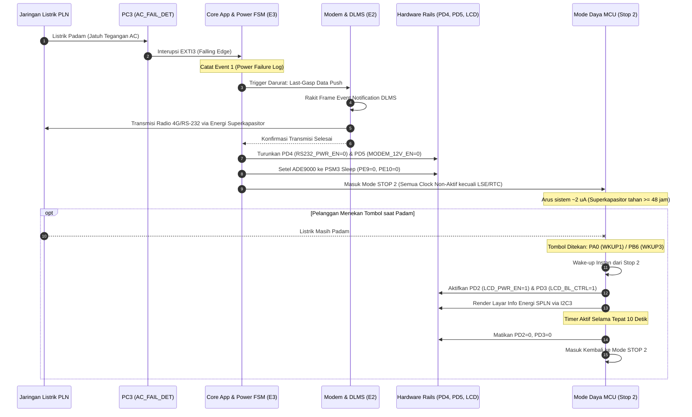

# Panduan Lengkap Konfigurasi STM32CubeMX (MX)
## Smart Meter 3-Fasa Berbasis STM32U585VIT6 & SPLN D3.006: 2021

Dokumen ini merupakan panduan arsitektur, pemetaan perangkat keras (*pinout*), alokasi domain keamanan **ARM TrustZone (Cortex-M33)**, serta konfigurasi peripheral pada **STM32CubeMX (`ALLIN.ioc`)**. Seluruh konfigurasi disusun berdasarkan integrasi tiga pilar firmware:
- **Pilar E1 (Metrology Lead):** Antarmuka AFE ADE9000 3-Fasa, transaksi SPI1 berkecepatan tinggi, kalibrasi *gain/phase*, serta deteksi kualitas daya dan anomali kelistrikan.
- **Pilar E2 (Protocol Lead - DLMS/COSEM):** Tumpukan protokol DLMS/COSEM (lapisan HDLC, APDU, Kamus Register OBIS, Keamanan HLS/AES-GCM), port komunikasi optik lokal (USART3), dan modem jarak jauh RS-232 (LPUART1/USART2) untuk transmisi *Last-Gasp Data Push*.
- **Pilar E3 (Application, HMI, Tamper & RTOS Orchestration Lead):** Tampilan layar STN LCD / OLED 3-baris standar SPLN Gambar 4 (I2C3), manajemen 9 vektor sabotase fisik/listrik (TAMP/EXTI), FSM pemutus beban/relai (*Shunt Trip* MCCB), perekam profil beban 15-menitan (*Load Profile*) ke memori eksternal 4 MB SPI NOR Flash/FRAM (SPI2), dan penjadwalan multitasking FreeRTOS.
- **Dokumen Referensi Perangkat Keras:** `PIN.docx` (Spesifikasi Pinout Resmi Hardware Spin 1).

---

## 1. Arsitektur Sistem & Aliran Sinyal

```mermaid
flowchart TD
    subgraph E1_Domain["Pilar E1: Metrologi Listrik (ADE9000)"]
        AFE["IC Metrologi ADE9000"]
        SPI1["SPI1: PA4 (SS), PA5 (SCK), PA6 (MISO), PA7 (MOSI)"]
        IRQ0_1["Interupsi: PB5 (IRQ0), PB1 (IRQ1), PE11 (EVENT)"]
        ZX_SIG["Zero-Crossing: PE8 (ADE_CF3_ZX)"]
        CF_SIG["Pulsa Kalibrasi: PE12 (CF1 Wh), PE13 (CF2 VARh)"]
        AFE <--> SPI1
        AFE --> IRQ0_1
        AFE --> ZX_SIG
        AFE --> CF_SIG
    end

    subgraph E2_Domain["Pilar E2: Komunikasi DLMS/COSEM"]
        OPTICAL["Port Optik Lokal: USART3 (PC4/PC5) @ 9.600 bps"]
        MODEM_PORT["Port Remote Modem: LPUART1/USART2 (PA2/PA3) @ 19.200 bps"]
        MODEM_CTL["Kontrol Daya: PD4 (RS232_PWR_EN), PD5 (MODEM_12V_EN)"]
    end

    subgraph E3_Domain["Pilar E3: HMI, Relai, Tamper & Storage"]
        LCD_BUS["Layar Matriks STN LCD 3-Baris: I2C3 (PC0/PC1)"]
        LCD_PWR["Daya Layar: PD2 (LCD_PWR_EN), PD3 (LCD_BL_CTRL)"]
        BUTTONS["Tombol HMI: PA0 (BTN_UP/WKUP1), PB6 (BTN_DN/WKUP3)"]
        TAMPER_SENS["Sensor Sabotase: PC13 (Case), PE6 (Terminal), PE4 (Magnet)"]
        RELAY_CTL["Relai Beban: PC8 (TRIP Shunt), PC7 (STATUS Feedback)"]
        NVM_FLASH["Eksternal NVM 4 MB: SPI2 (PB12-PB15)"]
        POWER_SUPV["Supervisi Daya: PC3 (AC_FAIL), PD11 (VBAT), PC2 (VCAP)"]
    end

    subgraph MCU_Core["Target MCU: STM32U585VIT6 (LQFP100)"]
        subgraph Secure_World["Secure World (Cortex-M33 S)"]
            SEC_RTC["RTC & TAMP Engine (VSW Domain)"]
            SEC_CRYPTO["Hardware Crypto: SAES, PKA, True RNG"]
            SEC_PULSE["Independent Energy Pulse Counter (PE12, PE13)"]
            SEC_WDI["Watchdog Heartbeat Driver (PD12)"]
            SEC_CALIB["Legal Metrology Calibration & Secret Keys"]
        end

        subgraph NonSecure_World["Non-Secure World (Cortex-M33 NS)"]
            NS_RTOS["FreeRTOS Kernel & Tasks Orchestrator"]
            NS_UI["Task HMI Display (SPLN Gambar 4 Carousel)"]
            NS_DLMS["Task Server Protokol DLMS/COSEM"]
            NS_FSM["Task Relay Limiter & Tamper Manager"]
            NS_PROF["Task Profil Beban 15-Menitan (NVM SPI2)"]
        end
    end

    E1_Domain --> MCU_Core
    E2_Domain --> MCU_Core
    E3_Domain --> MCU_Core
    Secure_World <-->|Non-Secure Callable (NSC) Gateways| NonSecure_World
```

---

## 2. Tabel Master Konfigurasi Pinout CubeMX (`PIN.docx`)

Tabel berikut memuat pemetaan 100% pin mikrokontroler STM32U585VIT6 paket LQFP100 sesuai standar operasional meter SPLN D3.006: 2021:

| No | Pin MCU | Sinyal Fungsional (`GPIO_Label`) | Mode Peripheral di CubeMX | Sifat Sinyal & Kecepatan | Pilar | Domain TrustZone | Peran Fungsional & Kepatuhan Standar |
|:---:|:---|:---|:---|:---|:---:|:---:|:---|
| 1 | **NRST** | `RESET` | System Reset | Input Internal Pull-Up | Sys | Secure / Sys | Jalur hardware reset sistem MCU. |
| 2 | **VBAT** | `VBAT_IN` | Power Supply Pin | 1.65 V – 3.6 V | Sys | Secure | Suplai Baterai Lithium Li-SOCl2 3.6 V untuk domain VSW (RTC, LSE, TAMP, Backup SRAM 2 KB). |
| 3 | **PC14** | `TCXO_32K_IN` | `RCC_OSC32_IN` | LSE Bypass Mode (FT_o) | Sys | Secure | Input Clock Eksternal TCXO 32.768 kHz (+ LSECSS aktif untuk deteksi `ERR02`). |
| 4 | **PC15** | `NC_PC15` | `NC (Not Connected)` | Not Connected | Sys | - | Jalur NC (Not Connected) / Tidak digunakan (LSE menggunakan mode Bypass 1-pin di PC14). |
| 5 | **PH0** | `OSC_IN` | `RCC_OSC_IN` | Input Kristal HSE (FT) | Sys | Secure / Sys | Input Kristal Utama HSE (16 MHz) (Titik simulasi pelepasan kristal uji watchdog). |
| 6 | **PH1** | `OSC_OUT` | `RCC_OSC_OUT` | Output Kristal HSE (FT) | Sys | Secure / Sys | Output Kristal Utama HSE. |
| 7 | **PB2** | `RTC_CAL_OUT` | `RTC_OUT2` | Push-Pull, High Speed | Sys | Secure | Pin uji kalibrasi RTC dedicated (1 Hz / 512 Hz) untuk verifikasi *time drift* via Frequency Counter. |
| 8 | **PC13** | `TAMP_CASE_OPEN` | `TAMP_IN1` | Active on VSW, Filter On | **E3** | **Secure** | Sabotase Tutup Meter: Catat ke Tamper Log, tampilkan "RUSAK", dan buka relai pemutus beban. |
| 9 | **PE6** | `TAMP_TERM_COVER`| `TAMP_IN3` | Active on VSW, Filter On | **E3** | **Secure** | Sabotase Tutup Terminal: Catat `ERR20`, tampilkan "PERIKSA", dan buka relai beban. |
| 10 | **PE4** | `SENSOR_MAGNET` | `GPIO_EXTI4` / `TAMP_IN7`| Active on VSW (FT_hat) | **E3** | **Secure** | Deteksi Induksi Medan Magnet Luar $\le$ 500 mT: Catat `ERR25` ("PERIKSA") tanpa trip relai. |
| 11 | **PC3** | `AC_FAIL_DET` | `GPIO_EXTI3` | Falling & Rising Edge | **E3** | Secure / NS | Deteksi catu PLN padam/menyala: Pemicu darurat *Last-Gasp Data Push* & transisi ke mode Stop 2. |
| 12 | **PD11**| `VBAT_SENSE` | `ADC4_IN15` | Analog Input | **E3** | Non-Secure | Monitor tegangan baterai cadangan (pemicu `ERR03` & ikon baterai berkedip jika $\le$ 2.7 V). |
| 13 | **PC2** | `VCAP_SENSE` | `ADC4_IN3` (atau ADC1_IN3) | Analog Input | **E3** | Non-Secure | Monitor tegangan superkapasitor (deteksi kerusakan superkapasitor `ERR06` & batas transisi 2.7 V). |
| 14 | **PC0** | `LCD_I2C3_SCL` | `I2C3_SCL` (AF4) | Open-Drain, Pull-Up, High | **E3** | Non-Secure | Clock I2C3 untuk Driver Layar STN LCD 3-Baris (Mendukung operasi hemat daya Stop 2 via LPBAM). |
| 15 | **PC1** | `LCD_I2C3_SDA` | `I2C3_SDA` (AF4) | Open-Drain, Pull-Up, High | **E3** | Non-Secure | Data I2C3 untuk Driver Layar Matriks STN LCD 3-Baris SPLN Gambar 4. |
| 16 | **PD2** | `LCD_PWR_EN` | `GPIO_Output` (LPGPIO1_P7) | Push-Pull, Low, Init Low | **E3** | Non-Secure | Sakelar catu LCD: Aktif 10 detik saat tombol ditekan pada kondisi listrik PLN padam. |
| 17 | **PD3** | `LCD_BL_CTRL` | `GPIO_Output` | Push-Pull, Low, Init Low | **E3** | Non-Secure | Kontrol backlight LCD: Menyala otomatis saat tombol ditekan (termasuk 10 detik saat padam). |
| 18 | **PA0** | `BTN_SCROLL_UP` | `GPIO_EXTI0` / `SYS_WKUP1`| Input Pull-Up, Falling Edge| **E3** | Non-Secure | Tombol navigasi Naik (▲), bangun MCU saat padam, & konfirmasi remote reconnect. |
| 19 | **PB6** | `BTN_SCROLL_DN` | `GPIO_EXTI6` / `SYS_WKUP3`| Input Pull-Up, Falling Edge| **E3** | Non-Secure | Tombol navigasi Turun (▼), bangun MCU saat padam, & kombinasi konfirmasi (▲+▼). |
| 20 | **PB7** | `LED_ALM` | `GPIO_Output` | Push-Pull, Low, Init Low | **E3** | Non-Secure | Driver Indikator LED Kuning (*Super Bright*) peringatan tamper dan alarm sistem. |
| 21 | **PA2** | `MODEM_TX` | `LPUART1_TX` (AF8) / `USART2_TX`| Push-Pull, High Speed | **E2** | Non-Secure | Jalur TX RS-232 konektor RJ-45 Pin 5 ke transceiver MAX3232 (19.200 bps). |
| 22 | **PA3** | `MODEM_RX` | `LPUART1_RX` (AF8) / `USART2_RX`| Pull-Up, High Speed (+DMA) | **E2** | Non-Secure | Jalur RX RS-232 konektor RJ-45 Pin 4 (19.200 bps, aktif di mode Stop 2 jika LPUART1). |
| 23 | **PD4** | `RS232_PWR_EN` | `GPIO_Output` | Push-Pull, Low, Init Low | **E2** | Non-Secure | Kontrol daya transceiver RS-232 (`FORCEOFF`): Dimatikan paska *Last-Gasp Push* saat padam. |
| 24 | **PD5** | `MODEM_12V_EN` | `GPIO_Output` | Push-Pull, Low, Init Low | **E2** | Non-Secure | Pemutus suplai catu daya modem 12 VDC (5 W) setelah transmisi darurat *Last-Gasp* selesai. |
| 25 | **PC4** | `OPTICAL_TX` | `USART3_TX` (AF7) | Push-Pull, High Speed | **E2** | Non-Secure | Port Komunikasi Lokal: Jalur Kirim Optical Probe isolasi galvanis > 4 kV (9.600 bps). |
| 26 | **PC5** | `OPTICAL_RX` | `USART3_RX` (AF7) | Pull-Up, High Speed (WKUP5)| **E2** | Non-Secure | Port Komunikasi Lokal: Jalur Terima Optical Probe depan meter (9.600 bps). |
| 27 | **PC8** | `RELAY_TRIP` | `GPIO_Output` | Pull-Down, Low, Init Low | **E3** | Non-Secure | Kontrol Pemutus Utama (Shunt Trip MCCB eksternal maks 240 VAC, 2 A via Disconnect Control). |
| 28 | **PC9** | `NC_PC9` | `NC (Not Connected)` | Not Connected | **E3** | - | **Ditiadakan / Tidak Digunakan:** Sistem hanya menggunakan 1 jalur pemutus koil *Shunt Trip* di pin `PC8` (`RELAY_TRIP`). |
| 29 | **PC7** | `RELAY_STATUS` | `GPIO_EXTI7` | Input Pull-Down, Both Edges | **E3** | Non-Secure | Umpan balik status kontak fisik relai untuk mendeteksi kegagalan mekanikal `ERR07`. |
| 30 | **PD8** | `AUX_CTRL_OUT1`| `GPIO_Output` | Push-Pull, Low, Init Low | **E3** | Non-Secure | Kontrol Bantu Output 1: Menggerakkan Opto-SSR/Relai Bantu (maks 288 VAC/300 VDC, 50 mA). |
| 31 | **PD10**| `AUX_CTRL_IN1` | `GPIO_EXTI10` | Input Pull-Up, Falling Edge| **E3** | Non-Secure | Kontrol Bantu Input 1: Membaca sinyal optocoupler 1 (60–288 VAC / 300 VDC, maks 3 mA). |
| 32 | **PD14**| `AUX_CTRL_IN2` | `GPIO_EXTI14` | Input Pull-Up, Falling Edge| **E3** | Non-Secure | Kontrol Bantu Input 2: Membaca sinyal optocoupler 2 (60–288 VAC / 300 VDC, maks 3 mA). |
| 33 | **PD12**| `EXT_WDI_PULSE`| `GPIO_Output` | Push-Pull, Medium Speed | **E3** | **Secure** | Heartbeat pulsa External Watchdog Unit (Jika CPU hang/kristal lepas, HW membuka relai & `ERR04`). |
| 34 | **PA4** | `ADE_SS` | `GPIO_Output` | Push-Pull, Very High, High | **E1** | Secure / NS | SPI1 Chip Select (CS) aktif rendah ke AFE Metrologi 3-Fasa ADE9000. |
| 35 | **PA5** | `ADE_SCK` | `SPI1_SCK` (AF5) | Very High Speed | **E1** | Secure / NS | Serial Clock SPI1 ke ADE9000 (10–20 MHz). |
| 36 | **PA6** | `ADE_MISO` | `SPI1_MISO` (AF5) | Very High Speed | **E1** | Secure / NS | MISO SPI1 dari ADE9000 (Membaca sampel gelombang 24-bit, RMS, Daya, Energi, THD, TDD). |
| 37 | **PA7** | `ADE_MOSI` | `SPI1_MOSI` (AF5) | Very High Speed | **E1** | Secure / NS | MOSI SPI1 ke ADE9000. |
| 38 | **PB5** | `ADE_IRQ0` | `GPIO_EXTI5` | Input Pull-Up, Falling Edge| **E1** | Secure / NS | HW IRQ0: Fasa balik (`ERR21`), Arus-Tegangan tidak sefase (`ERR22`), Reverse Power (`ERR26`). |
| 39 | **PB1** | `ADE_IRQ1` | `GPIO_EXTI1` | Input Pull-Up, Falling Edge| **E1** | Secure / NS | HW IRQ1: Netral putus (`ERR23`), Hilang fasa (`ERR24`), Voltage Dip/Sag & Swell. |
| 40 | **PE11**| `ADE_EVENT` | `GPIO_EXTI11` | Input Pull-Up, Falling Edge| **E1** | Secure / NS | Power Quality Event (Dip, Sag, Swell, Overcurrent, Asimetri fasa > 30%). |
| 41 | **PE7** | `ADE_RESET` | `GPIO_Output` | Push-Pull, High, Init High | **E1** | Secure / NS | Hardware Reset ADE9000 aktif rendah (mereset IC metrologi jika sampling ADC berhenti). |
| 42 | **PE8** | `ADE_CF3_ZX` | `GPIO_EXTI8` | Input No Pull, Both Edges | **E1/E3**| Secure / NS | Deteksi Zero-Crossing AC untuk Zero-Current Switching pemutus beban (mencegah busur api relai). |
| 43 | **PE9** | `ADE_PM0` | `GPIO_Output` | Push-Pull, Low, Init Low | **E1** | Secure / NS | Kontrol Power Mode 0 ADE9000 (bekerja bersama PM1: PSM0 Run / PSM2 Tamper / PSM3 Sleep). |
| 44 | **PE10**| `ADE_PM1` | `GPIO_Output` | Push-Pull, Low, Init Low | **E1** | Secure / NS | Kontrol Power Mode 1 ADE9000: Menurunkan mode daya saat padam agar supercap tahan $\ge$ 48 jam. |
| 45 | **PE12**| `ADE_CF1` | `GPIO_EXTI12` (atau LPTIM) | Input Pull-Up, Falling Edge| **E1** | **Secure** | Input Pencacah Pulsa Kalibrasi Energi Aktif (Imp/kWh) untuk independen HW energy counter. |
| 46 | **PE13**| `ADE_CF2` | `GPIO_EXTI13` (atau LPTIM) | Input Pull-Up, Falling Edge| **E1** | **Secure** | Input Pencacah Pulsa Kalibrasi Energi Reaktif (Imp/kvarh) untuk validasi silang register VARh. |
| 47 | **PB12**| `FLASH_SPI2_CS` | `GPIO_Output` | Push-Pull, Very High, High | **E3** | Non-Secure | Chip Select NVM Eksternal (SPI NOR Flash / FRAM kapasitas 4 MB $\ge$ 1.024 kB syarat SPLN). |
| 48 | **PB13**| `FLASH_SPI2_SCK`| `SPI2_SCK` (AF5) | Very High Speed | **E3** | Non-Secure | Clock SPI2 NVM Eksternal (Load Profile 3 bulan, Billing 12 bulan, Log FIFO kejadian). |
| 49 | **PB14**| `FLASH_SPI2_MISO`|`SPI2_MISO` (AF5) | Very High Speed | **E3** | Non-Secure | MISO SPI2 NVM Eksternal (Kegagalan respon memori memicu `ERR00`). |
| 50 | **PB15**| `FLASH_SPI2_MOSI`|`SPI2_MOSI` (AF5) | Very High Speed | **E3** | Non-Secure | MOSI SPI2 NVM Eksternal. |
| 51 | **PA13**| `SWDIO` | `DEBUG_JTMS-SWDIO` | AF0 (Pull-Up) | Sys | Secure | SWD Data ST-LINK (Wajib proteksi TrustZone & RDP Level 2 pada firmware rilis). |
| 52 | **PA14**| `SWCLK` | `DEBUG_JTCK-SWCLK` | AF0 (Pull-Down) | Sys | Secure | SWD Clock ST-LINK. |
| 53 | **Rail**| `LED_POWER_ON` | Regulator Hardware DC | Hardwired ke Power Rail | Sys | Hardware | Indikator LED Hijau (*Super Bright*) penanda kehadiran catu daya fasa tegangan. |

---

## 3. Konfigurasi Peripheral & Clock Tree di STM32CubeMX

### A. Clock Configuration (RCC Tree)
1. **LSE (Low Speed External - 32.768 kHz)**:
   - Pilih `LSE` $\rightarrow$ **`BYPASS Clock Source`** (karena osilator masuk dari IC TCXO aktif ke pin `PC14`).
   - Aktifkan **LSECSS (LSE Clock Security System)** untuk mengawasi kegagalan osilator waktu dan memicu pencatatan error `ERR02`.
   - Pin `PC15` dibiarkan **NC (Not Connected)** / tidak dikonfigurasi.
2. **HSE (High Speed External - 16.000 MHz)**:
   - Pilih `HSE` $\rightarrow$ **`Crystal/Ceramic Resonator`** (`PH0` & `PH1`).
   - Aktifkan **HSECSS** untuk mengamankan clock sistem terhadap kegagalan kristal eksternal (uji pelepasan kristal watchdog).
3. **PLL & System Clock (SYSCLK)**:
   - Sumber PLL = `HSE (16 MHz)`.
   - Parameter PLL1: $M = 1$, $N = 20$, $P = 2$, $Q = 2$, $R = 2 \rightarrow$ **SYSCLK = 160 MHz**.
   - Clock Domain Low Power: Arahkan clock `LPUART1` dan `I2C3` ke sumber **`LSE` (32.768 kHz)** agar peripheral ini dapat beroperasi di mode Stop 2 tanpa membutuhkan clock PLL berdaya tinggi.

### B. Alokasi Domain Keamanan ARM TrustZone (GTZC & SAU)
Sesuai standar **SPLN D3.006: 2021**, **OIML R46**, dan **WELMEC 7.2**:

#### 1. Secure World (Cortex-M33 S)
- **TAMP & RTC Peripheral:** Seluruh penanganan sabotase fisik (`PC13` Case Open, `PE6` Terminal Open, `PE4` Magnet) diisolasi di Secure World pada domain daya $V_{SW}$ / $V_{BAT}$.
- **Hardware Crypto Engine (SAES & PKA):** Kunci otentikasi HLS (*High-Level Security*) dan enkripsi AES-128 GCM milik pilar E2 disimpan dan diproses secara eksklusif di dalam Secure Flash / SRAM.
- **Independent Hardware Pulse Counting:** Interupsi pulsa kalibrasi meter `ADE_CF1` (`PE12`) dan `ADE_CF2` (`PE13`) ditangani oleh Secure Timer / EXTI untuk akumulasi energi independen sebagai pembanding (*cross-check*) register SPI.
- **External Watchdog Pulse (`PD12`):** Dikendalikan oleh thread Secure untuk menjamin integritas firmware secara keseluruhan.
- **Tabel Panggilan Non-Secure Callable (`secure_nsc.c`):** Mengekspos fungsi baca terproteksi untuk Non-Secure World:
  ```c
  CMSE_NS_ENTRY uint32_t SECURE_GetActiveEnergyWh(void);
  CMSE_NS_ENTRY uint32_t SECURE_GetTamperStatusMask(void);
  CMSE_NS_ENTRY uint32_t SECURE_GetRTCDateTime(void);
  ```

#### 2. Non-Secure World (Cortex-M33 NS)
- **FreeRTOS Operating System:** Seluruh scheduler, task, queue, dan mutex aplikasi beroperasi pada domain Non-Secure.
- **HMI Display Task (Pilar E3):** Mengendalikan bus `I2C3` (`PC0/PC1`) dan pin daya layar `PD2`/`PD3`.
- **DLMS/COSEM Engine (Pilar E2):** Mengelola komunikasi HDLC, APDU parsing, dan kamus OBIS melalui `USART3` (Optik) dan `LPUART1`/`USART2` (Modem RS-232).
- **Relay Limiter & FSM (Pilar E3):** Memproses evaluasi beban lebih, asimetri arus $>30\%$, dan mengendalikan koil shunt trip (`PC8`). Pin `PC9` ditiadakan (NC).
- **Load Profile & NVM (Pilar E3):** Mengendalikan bus `SPI2` (`PB12-PB15`) untuk menulis data riwayat konsumsi 15-menitan ke memori Flash/FRAM eksternal.

---

## 4. Konfigurasi Rinci Peripheral Komunikasi & Aktuator

### A. SPI1 (Pilar E1 - Metrologi ADE9000)
- **Mode:** Full-Duplex Master
- **Hardware NSS Signal:** Disable (Software NSS via `PA4` `ADE_SS`)
- **Frame Format:** Motorola, Data Size: 16-bit (atau 8-bit sesuai paket transaksi driver E1)
- **Clock Polarity & Phase:** CPOL = Low, CPHA = 2 Edge (Mode 1) atau CPOL = High, CPHA = 2 Edge (Mode 3)
- **Baudrate:** 10.0 MHz (Prescaler /16 dari APB2 160 MHz)
- **GPIO Pins:** `PA4` (Output Push-Pull Very High Speed), `PA5` (SCK AF5), `PA6` (MISO AF5), `PA7` (MOSI AF5)

### B. SPI2 (Pilar E3 - NVM 4 MB Storage)
- **Mode:** Full-Duplex Master
- **Hardware NSS Signal:** Disable (Software NSS via `PB12` `FLASH_SPI2_CS`)
- **Clock Polarity & Phase:** Mode 0 (CPOL = Low, CPHA = 1 Edge)
- **Baudrate:** 20.0 MHz
- **GPIO Pins:** `PB12` (Output Push-Pull Very High Speed), `PB13` (SCK AF5), `PB14` (MISO AF5), `PB15` (MOSI AF5)

### C. I2C3 (Pilar E3 - Layar STN LCD / OLED 3-Baris)
- **Mode:** I2C Fast Mode (400 kHz)
- **Analog Filter:** Enabled
- **Address Mode:** 7-Bit
- **GPIO Pins:** `PC0` (I2C3_SCL AF4, Open-Drain, Pull-Up), `PC1` (I2C3_SDA AF4, Open-Drain, Pull-Up)
- **Low Power Feature:** Mampu beroperasi di Stop 2 via Smart Run Domain / LPBAM.

### D. LPUART1 / USART2 (Pilar E2 - Modem RS-232 Remote)
- **Mode:** Asynchronous
- **Baud Rate:** 19.200 bps, Data Bits: 8, Parity: None, Stop Bits: 1
- **DMA Settings:** LPDMA1 / GPDMA Channel pada RX dengan mode **Circular** untuk menerima request frame HDLC tanpa membebani interupsi CPU.
- **Wake-up Capability:** Diaktifkan dari mode Stop 2 pada deteksi karakter START/Address.

### E. USART3 (Pilar E2 - Port Optik Depan)
- **Mode:** Asynchronous
- **Baud Rate:** 9.600 bps, Data Bits: 8, Parity: None, Stop Bits: 1
- **Pins:** `PC4` (TX AF7 Push-Pull), `PC5` (RX AF7 Pull-Up, didukung jalur wake-up `WKUP5`)

### F. ADC4 (Pilar E3 - Supervisi Baterai & Superkapasitor)
- **Clock Source:** LSE / SYSCLK (aktif otonom di mode Stop 2)
- **Resolusi:** 12-Bit
- **Channels:**
  - `Channel 15` (`PD11` / `VBAT_SENSE`): Mengukur tegangan sel baterai Li-SOCl2. Ambang batas kritis $\le 2.7\ \text{V}$ memicu peringatan baterai habis (`ERR03`).
  - `Channel 3` (`PC2` / `VCAP_SENSE`): Mengukur tegangan rail superkapasitor untuk verifikasi cadangan pemadaman $\ge 4$ jam (`ERR06`).

---

## 5. Manajemen Daya Ekstrem: Siklus AC Fail, Last-Gasp & Stop 2

SPLN D3.006: 2021 mewajibkan meter tetap mampu mengirim data pemadaman ke HES dan menampilkan informasi layar saat tombol ditekan ketika listrik PLN padam:



---

## 6. Penyesuaian Kritis: Purwarupa E3 vs Dokumen PIN Resmi

Saat melakukan porting dari kode pengujian mandiri di folder `E3/` ke target hardware `ALLIN.ioc`:

> [!WARNING]
> **1. Alih Peripheral Layar (I2C1 ke I2C3):**
> Pada driver pengujian lama (`E3/drivers/oled/src/bsp_display_oled.c`), digunakan `I2C1` pada pin `PB8` & `PB9`. Pada dokumen perangkat keras resmi `PIN.docx`, display **wajib dialihkan ke `I2C3` pada pin `PC0` (SCL) dan `PC1` (SDA)** yang didukung kontrol catu daya `PD2` (`LCD_PWR_EN`) dan lampu latar `PD3` (`LCD_BL_CTRL`).

> [!IMPORTANT]
> **2. Relokasi Pin Interupsi ADE9000 (IRQ0):**
> Pin `ADE_IRQ0` dipindahkan ke **`PB5` (EXTI5)** agar pin **`PA0` (EXTI0)** dapat digunakan secara eksklusif untuk tombol navigasi **`BTN_SCROLL_UP`** yang terhubung langsung ke modul hardware wake-up **`SYS_WKUP1`**.

> [!NOTE]
> **3. Sinkronisasi Zero-Crossing (PE8 ADE_CF3_ZX):**
> Pin `PE8` wajib dikonfigurasi sebagai interupsi dual-edge. Logika pembukaan relai `PC8` (`RELAY_TRIP`) harus dieksekusi tepat pada titik perlintasan nol arus (*Zero-Current Switching*) untuk mencegah keausan kontak relai akibat percikan busur api (*arcing*). Pin `PC9` ditiadakan (NC).

---

## 7. Panduan Langkah Konfigurasi pada Antarmuka STM32CubeMX

1. **Buka Proyek:**
   - Jalankan STM32CubeMX dan buka berkas [`ALLIN.ioc`](file:///g:/PPPP/ALLIN/ALLIN.ioc).
2. **System Core & Security:**
   - Masuk ke tab **Pinout & Configuration** $\rightarrow$ **System Core**.
   - Pada **TAMP**, tetapkan `TAMP_IN1` (`PC13`), `TAMP_IN3` (`PE6`), dan `TAMP_IN7` (`PE4`) ke domain **Secure**.
   - Pada **RTC**, aktifkan `Activate Clock Source`, tetapkan `RTC_OUT2` (`PB2`) ke mode *Calibration 512Hz/1Hz Output*.
   - Pada **GTZC (Global TrustZone Controller)**, alokasikan peripheral penagihan dan kriptografi (SAES, PKA, RTC, TAMP) sebagai **Secure**, sedangkan peripheral aplikasi (I2C3, SPI2, LPUART1, USART3, ADC4) sebagai **Non-Secure**.
3. **Connectivity:**
   - **SPI1:** Konfigurasi Full-Duplex Master (PA5-PA7, PA4 sebagai GPIO Output `ADE_SS`).
   - **SPI2:** Konfigurasi Full-Duplex Master (PB13-PB15, PB12 sebagai GPIO Output `FLASH_SPI2_CS`).
   - **I2C3:** Konfigurasi I2C Fast Mode pada pin `PC0` & `PC1`.
   - **LPUART1:** Asynchronous pada `PA2` & `PA3`, aktifkan interupsi global dan DMA RX Circular.
   - **USART3:** Asynchronous pada `PC4` & `PC5`.
4. **Analog:**
   - **ADC4:** Aktifkan Channel 3 (`PC2`) dan Channel 15 (`PD11`), konfigurasi mode ultra-low power.
5. **GPIO Configurations:**
   - Tetapkan seluruh label pin (`GPIO_Label`), pull-up/pull-down, dan trigger edge sesuai **Tabel Master Bab 2**.
6. **Clock Configuration:**
   - Pastikan LSE Bypass aktif di `PC14` dengan LSECSS dicentang.
   - Konfigurasi PLL1 menghasilkan HCLK/SYSCLK = 160 MHz.
7. **Generate Code:**
   - Simpan berkas `.ioc` dan klik tombol **Generate Code** untuk memperbarui kode inisialisasi pada direktori [`Secure`](file:///g:/PPPP/ALLIN/Secure) dan [`NonSecure`](file:///g:/PPPP/ALLIN/NonSecure).

