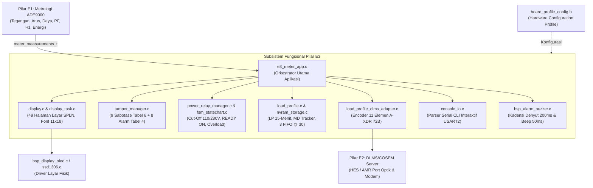

# Panduan Lengkap Fundamental & Fungsi Berkas Pilar E3 (ALLIN Smart Meter)

---

## 1. Pendahuluan & Filosofi Arsitektur Pilar E3

Pilar E3 merupakan **Lapisan Inti Aplikasi (*Application Core Layer*) & HMI** pada sistem Smart Meter 3-Fasa ALLIN berbasis mikrokontroler STM32U585. Pilar ini bertanggung jawab langsung atas pemenuhan seluruh regulasi kelistrikan nasional Indonesia:
- **SPLN D3.006: 2021** (Spesifikasi Meter Statip Fase Tiga Prabayar & Pascabayar)
- **SPLN D3.002: 2021** (Interoperabilitas Pengukuran)
- Standar Internasional **IEC 62056 (DLMS/COSEM)**

### Prinsip Desain Fundamental E3:
1. **Separation of Concerns (Pemisahan Tanggung Jawab Mutlak):**
   Pilar E3 tidak melakukan kalkulasi sinyal analog ADC (diserahkan ke Pilar E1 / ADE9000) dan tidak menangani framing protokol jaringan (diserahkan ke Pilar E2 / DLMS). E3 fokus murni pada logika bisnis meter, pengamanan sabotase, pemutus relai, antarmuka layar, dan pencatatan riwayat transaksi.
2. **MCU & Hardware Independence (Portabilitas 100% C99):**
   Seluruh algoritma di `E3/app/` ditulis dalam bahasa C standar murni (C99), bebas dari dependensi register mikrokontroler STM32. Jika MCU diganti di masa depan, kode logika bisnis di E3 tidak perlu diubah sama sekali.
3. **Dependency Injection & Hardware Abstraction Layer (HAL):**
   Komponen fisik seperti layar (OLED vs Segment LCD), media penyimpanan (SPI Flash vs EEPROM), dan koil relai dihubungkan hanya melalui kontrak antarmuka *function pointer* atau berkas konfigurasi terpusat `board_profile_config.h`.

---

## 2. Peta Arsitektur & Aliran Data Pilar E3



---

## 3. Rincian Fungsi Tiap Berkas di Pilar E3

Struktur folder Pilar E3 dibagi menjadi 6 kelompok modul:

```
E3/
├── app/                  # Inti Logika Aplikasi Meter & Konfigurasi Papan
│   ├── console/          # Parser Serial Konsol Interaktif CLI
│   ├── display/          # HMI, Format Layar SPLN Gambar 4 & 49 Halaman
│   ├── fsm/              # Master Statechart, Pengendali Relai & FreeRTOS Tasks
│   ├── profiling/        # Load Profile 15-Menit, Maximum Demand & Storage NVRAM
│   └── tamper/           # Manajer Sabotase Fisik/Elektrikal & Alarm Hardware
├── drivers/              # Board Support Package (BSP) Driver Perangkat Keras
│   ├── buzzer/           # Driver Audio Kadensi Buzzer
│   ├── oled/             # Driver Layar Fisik OLED SSD1306 (I2C3)
│   └── power/            # Driver Manajemen Hemat Daya STM32U5 Stop 2 Mode
├── docs/                 # Dokumentasi Teknis Sistem
└── tests/                # Rangkaian Pengujian Unit Test CTest (12 Test Suites)
```

---

### A. Inti Orkestrator & Konfigurasi Papan (`E3/app/`)

#### 1. `board_profile_config.h`
- **Tujuan & Fundamental:** Berkas konfigurasi profil papan terpusat (*Hardware Abstraction Layer Configuration*). Memisahkan variasi komponen fisik papan (Revisi A vs B, dev board vs mass production) dari kode logika aplikasi.
- **Fungsi Utama:**
  - Mendefinisikan profil papan aktif: `BOARD_PROFILE_PROTOTYPE_OLED`, `BOARD_PROFILE_PRODUCTION_SEGLCD`, atau `BOARD_PROFILE_HEADLESS_BENCH`.
  - Mengonfigurasi parameter layar: alamat I2C, timeout bangun 10 detik saat listrik padam (`BOARD_CFG_DISPLAY_WAKE_MS`).
  - Mengonfigurasi subsistem relai: tipe koil (dual-coil latching vs single-coil H-bridge), durasi pulsa (100 ms), ambang proteksi cut-off tegangan (<110V dan >280V), durasi stabil reconnect (5s).
  - Mengonfigurasi polaritas sensor sabotase (Normally Open vs Normally Closed) dan filter debounce (100 ms, 3s verifikasi magnet, 10s recovery).
  - Mengonfigurasi alokasi kapasitas buffer NVRAM: 100 entri load profile, 30 entri FIFO log, 12 bulan billing.

#### 2. `e3_meter_app.h` & `e3_meter_app.c`
- **Tujuan & Fundamental:** Pengorkestrator utama (*Master Coordinator*) Pilar E3. Berkas ini adalah "jantung" yang menyatukan seluruh subsistem E3 ke dalam siklus periodik runtime.
- **Fungsi Utama:**
  - `e3_meter_app_init()`: Menginisialisasi terpadu layar, manajer tamper, relai, buffer load profile, tracker MD, dan power rails perifer.
  - `e3_meter_app_step()`: Dieksekusi siklis tiap detik / RTOS tick:
    1. Mengirim heartbeat pulsa ke External Watchdog hardware (PD12).
    2. Menghitung akumulasi detik Epoch UNIX untuk penentuan jam/tanggal real-time (WIB UTC+7).
    3. Membaca sakelar fisik tamper (PC13, PE6, PE4) dan mendeteksi tamper elektrikal fasa/netral.
    4. Mengukur telemetri tegangan baterai (PD11) dan superkapasitor (PC2) via ADC4 (memicu alarm `ERR03` / `ERR06`).
    5. Mengeksekusi state machine relai pembatas beban, proteksi tegangan 110V/280V, dan pelacakan Maximum Demand.
    6. Memicu pembekuan berkala 15-Minute Load Profile dan penutupan tagihan bulanan (*End-of-Billing*).
    7. Mengompilasi data ke dalam struktur frame tampilan dan merendernya ke layar fisik.
  - `e3_meter_app_on_button()`: Menangani interupsi tombol navigasi; mengaktifkan lampu latar LCD 10 detik saat listrik padam (*Off-Power Wake-Up*) dan mengevaluasi tombol simultan (▲ + ▼) untuk rekoneksi relai status `READY ON`.
  - `e3_meter_app_on_ac_fail()`: Menangani kejadian padam listrik (*Last-Gasp*); segera menyimpan snapshot darurat ke Flash NVRAM dan memicu transmisi DLMS Push Notification.

---

### B. Subsistem Layar & HMI (`E3/app/display/`)

#### 3. `display.h` & `display.c`
- **Tujuan & Fundamental:** Mesin logika format tampilan layar sesuai standar **SPLN D3.006: 2021 Gambar 4**. Berkas ini bersifat 100% murni logika data tanpa dependensi hardware layar.
- **Fungsi Utama:**
  - Mendefinisikan struktur `meter_measurements_t` (kontrak universal pertukaran data metrologi kelistrikan dari E1).
  - Mengelola total **49 Halaman Layar Terverifikasi**:
    - **15 Halaman Auto-Carousel (Tabel E.1):** Berganti otomatis tiap 5 detik (Total kWh, Tarif 1 WBP, Tarif 2 LWBP1, Tarif 3 LWBP2, Ekspor PLTS, P_MAX, Tanggal MD, CMD, MD reset counter, kVARh, Jam, Tanggal).
    - **34 Halaman Manual Scrolling (Tabel E.2):** Tombol manual (Uji segmen '88888888', ID Meter, daya balik PLTS, sudut fasa tegangan & arus $Sdt\_UR..UT, Sdt\_IR..IT$, daya limit $P_{\text{LIM}}$, CSUM firmware, unit UP3, stand bulan lalu, status tamper, relai `READY ON`).
  - Mengompilasi 3 Baris Layar Fisik:
    - *Baris 1:* 7 Simbol wajib (Status Relai, Arah Daya/Kuadran, Satuan, Alarm/Tamper, Komunikasi, Baterai, Status Fasa R/S/T).
    - *Baris 2:* Nilai numerik besar font 11x18 (8 digit integer + desimal).
    - *Baris 3:* Kode OBIS resmi SPLN serta teks nama parameter.
    - *Pojok Kanan Atas:* Indeks halaman (*zz* 2 digit).
  - Mengatur rotasi kode error bergantian setiap 3 detik jika terjadi multi-alarm (`LOG-021`).
  - Menampilkan banner peringatan "Lo Volt" (<180V) dan "Hi Volt" (>260V) di baris 2 (`LOG-022`).

#### 4. `display_task.h` & `display_task.c`
- **Tujuan & Fundamental:** Jembatan pembungkus (*FreeRTOS Task Wrapper*) yang menghubungkan mesin data `display.c` ke driver layar fisik dengan pola *Dependency Injection*.
- **Fungsi Utama:**
  - Mendefinisikan antarmuka `display_driver_interface_t` (`init`, `render_frame`, `show_boot_screen`).
  - `display_task_set_driver()`: Memungkinkan injeksi driver layar apa pun saat runtime (OLED SSD1306, Kaca Segment LCD, atau Mock).
  - Menangani FreeRTOS event group untuk *instant refresh* ketika terjadi event sabotase mendadak tanpa menunggu interval timer carousel.

---

### C. Subsistem Sabotase & Alarm Kerusakan (`E3/app/tamper/`)

#### 5. `tamper_manager.h` & `tamper_manager.c`
- **Tujuan & Fundamental:** Manajer deteksi kecurangan / sabotase (*tamper*) dan diagnostik integritas hardware internal meter.
- **Fungsi Utama:**
  - Mendeteksi **9 Vektor Sabotase Lengkap (SPLN D3.006: 2021 Tabel 6)**:
    - `ERR20`: Tutup Meter Dibuka (*Top Cover Open*).
    - `ERR21`: Arus Netral Hilang / Terbalik (*Bypass Netral*).
    - `ERR22`: Urutan Fasa Terbalik (*Reverse Phase Sequence*).
    - `ERR23`: Hilang Fasa Tegangan (*Phase Loss*).
    - `ERR24`: Pengaruh Medan Magnet Eksternal 500 mT (Verifikasi stabil 3 detik & persistensi, `LOG-023`).
    - `ERR25`: Tutup Terminal Dibuka (*Terminal Cover Open*).
    - `ERR26`: Fasa dan Netral Tertukar (*Phase-Neutral Reversal*).
    - `ERR27`: Faktor Daya Rendah Abnormal ($\cos\varphi < 0.2$ Kuadran IV).
    - `ERR28`: Aliran Daya Balik Abnormal (*Reverse Power Flow*).
  - Mendeteksi **8 Alarm Kerusakan Hardware Internal (SPLN D3.006: 2021 Tabel 4)**:
    - `ERR00` (Memori Rusak), `ERR01` (RTC Rusak), `ERR02` (Metrologi ADE9000 SPI Fault), `ERR03` (Baterai Lemah <3.0V), `ERR04` (Port Serial Rusak), `ERR05` (Kontak Relai Rusak/Welded), `ERR06` (Superkapasitor Lemah <2.5V), `ERR07` (Checksum Kalibrasi Rusak).
  - Menyediakan fungsi penapis keputusan:
    - `spln_alarm_should_trip_relay()`: Menentukan apakah alarm wajib memutus relai (`ERR00..ERR05`).
    - `spln_alarm_should_turn_on_led()`: Mengendalikan nyala LED Kuning Alarm / Tamper (PB7).
  - Mengelola filter debounce sakelar mekanik (100 ms) agar tidak memicu *false positive*.

#### 6. `dlms_tamper_log.h`
- **Tujuan & Fundamental:** Definisi struktur data rekaman log sabotase berstandar DLMS/COSEM (Timestamp, Event Vector Code, Active Mask).

---

### D. Subsistem Pengendali Relai & Mesin Status FSM (`E3/app/fsm/`)

#### 7. `fsm_statechart.h` & `fsm_statechart.c`
- **Tujuan & Fundamental:** Mesin status hierarkis master (*Master Hierarchical Finite State Machine*) pengatur kondisi operasional meter.
- **Fungsi Utama:**
  - Mengelola transisi status: `STATE_NORMAL`, `STATE_OVERLOAD`, `STATE_TAMPER`, `STATE_RECONNECT_PENDING`, `STATE_OUTAGE`, `STATE_TEST`.
  - Menjaga konsistensi antar-subsistem: memastikan meter tidak bisa menyambung relai saat sabotase tutup meter masih terbuka.

#### 8. `power_relay_manager.h` & `power_relay_manager.c`
- **Tujuan & Fundamental:** Pengendali relai pemutus beban (*Latching Power Relay*) dan pembatas daya (*Power Limiter*).
- **Fungsi Utama:**
  - Mengendalikan status kontak: `RELAY_STATE_CONNECTED`, `RELAY_STATE_DISCONNECTED`, dan status pengaman `RELAY_STATE_READY_ON`.
  - **Proteksi Tegangan Ekstrem (SPLN Butir 10.3 / `LOG-025`):**
    - Cut-off tegangan rendah: Buka relai jika tegangan $< 110\text{V}$ selama 3 detik berturut-turut.
    - Cut-off tegangan lebih: Buka relai instan jika tegangan $> 280\text{V}$.
    - Auto-reconnect: Sambung kembali otomatis jika tegangan normal ($110\text{V} \dots 280\text{V}$) stabil selama 5 detik.
  - **Kurva Waktu Pembatas Beban (*Inverse-Time Overload Curve*):**
    - Toleransi kelebihan daya bertingkat (overload 100%–120% toleransi waktu puluhan detik; overload >150% trip instan).
  - **Prosedur Rekoneksi Aman `READY ON` (SPLN Tabel 5 No 12 / `LOG-020`):**
    - Setelah lockout period berakhir, relai masuk status `READY ON`. Relai tidak boleh menyambung otomatis; pengguna harus menekan tombol Atas dan Bawah secara **bersamaan (`BUTTON_DIR_BOTH`) selama $\ge 1$ detik** sebagai konfirmasi bahwa beban pelanggan sudah aman.
  - Deteksi asimetri beban antar-fasa R-S-T (>30%).

#### 9. `rtos_tasks.h` & `rtos_tasks.c`
- **Tujuan & Fundamental:** Pengatur pembagian thread FreeRTOS untuk eksekusi concurrent (Display Task, Metrology Task, Relay Task, DLMS Task).

---

### E. Subsistem Profiling, Maximum Demand & NVRAM (`E3/app/profiling/`)

#### 10. `load_profile.h` & `load_profile.c`
- **Tujuan & Fundamental:** Modul basis data rekaman Profil Beban 15-Menitan (ER-02) dan pelacak Kebutuhan Maksimum (Maximum Demand / MD).
- **Fungsi Utama:**
  - Mengelola ring buffer circular **100 entri** untuk Profil Beban 15-menit (900 detik).
  - Setiap entri mencatat 11 parameter kelistrikan (Timestamp, +A, -A PLTS, +R, $V_R, V_S, V_T, I_R, I_S, I_T$, Status Mask) yang diproteksi checksum CRC-16.
  - **Pelacak Maximum Demand 15-Menit (SPLN Tabel E.1 No 4–7):**
    - Mengintegrasikan daya rata-rata per detik selama window 900 detik.
    - Melacak nilai puncak tertinggi dalam bulan berjalan ($P_{\text{MAX}}$ kW dan $S_{\text{MAX}}$ kVA).
    - Mencatat waktu kejadian (*timestamp*) puncak demand, akumulasi kumulatif MD (CMD), dan counter reset MD.
  - **Snapshot Penagihan Bulanan 12 Bulan (SPLN Butir 6.13):**
    - Mengelola ring buffer 12 snapshot stand tagihan penutupan buku bulanan (*End-of-Billing / EoB*).

#### 11. `load_profile_dlms_adapter.h` & `load_profile_dlms_adapter.c`
- **Tujuan & Fundamental:** Adapter pemformat data A-XDR DLMS/COSEM Class ID 7 (*Profile Generic*) berstandar Green/Blue Book (`LOG-027`).
- **Fungsi Utama:**
  - `load_profile_encode_dlms_entry()`: Mengonversi struktur data profil beban internal menjadi stream byte **A-XDR 11 elemen presisi (tepat 72 Byte)**.
  - `tamper_log_encode_dlms_entry()`: Mengonversi entri tamper ke stream A-XDR 3 elemen (24 Byte).
  - `spln_log_encode_dlms_entry()`: Mengonversi entri log SPLN 4 elemen (27 Byte).
  - `dlms_decode_verify_structure()`: Parser verifikasi rekursif untuk memastikan integritas decoding stream A-XDR bebas dari underflow.

#### 12. `nvram_storage.h` & `nvram_storage.c`
- **Tujuan & Fundamental:** Pengelola penyimpanan memori non-volatile (SPI Flash W25Qxx eksternal / RAM mirror) yang menjamin integritas data saat meter mati total.
- **Fungsi Utama:**
  - Mengelola **3 Register FIFO Log Terpisah (SPLN D3.006 Butir 12.3 / `LOG-026`):**
    - FIFO 1: *Alarm Log Register* (kapasitas 30 entri).
    - FIFO 2: *Event Log Register* (kapasitas 30 entri).
    - FIFO 3: *Tamper Log Register* (kapasitas 30 entri).
  - Menyimpan dan memulihkan entri 15-Minute Load Profile ke sektor Flash eksternal.
  - Menghitung dan memvalidasi integritas data menggunakan CRC-16-CCITT.

---

### F. Subsistem Konsol Serial Interaktif CLI (`E3/app/console/`)

#### 13. `console_io.h` & `console_io.c`
- **Tujuan & Fundamental:** Parser antarmuka baris perintah serial (*Interactive Command Line Interface*) pada USART2 @ 115200 bps (`LOG-028`).
- **Fungsi Utama:**
  - Membantu pengujian pabrik, kalibrasi laboratorium, dan teknisi lapangan melalui terminal serial tanpa membongkar casing meter.
  - Mendukung **8 Perintah Interaktif**:
    - `help`: Menampilkan menu bantuan dan daftar perintah.
    - `status`: Menampilkan ringkasan status operasional meter (tegangan fasa, status relai, alarm aktif, frekuensi).
    - `relay [trip|reconnect]`: Perintah manual buka/tutup kontak relai.
    - `tamper [clear]`: Memeriksa status 9 vektor sabotase atau mereset alarm tamper.
    - `meter`: Menampilkan data instan lengkap (tegangan, arus fasa & netral, daya P/Q/S, PF, energi Wh).
    - `reset`: Memicu soft-reset mikrokontroler.
    - `log [alarm|event|tamper]`: Menginspeksi isi 30 entri pada 3 FIFO NVRAM.
    - `set [limit|time] <val>`: Mengonfigurasi ambang daya pembatas atau waktu jam meter.

---

### G. Driver Perangkat Keras / BSP (`E3/drivers/`)

#### 14. `bsp_alarm_buzzer.h`, `bsp_alarm_buzzer.c`, & `bsp_pin_mapping.h`
- **Tujuan & Fundamental:** Pengendali suara buzzer piezoelektrik sesuai regulasi SPLN.
- **Fungsi Utama:**
  - **Kadensi Denyut Alarm (SPLN Butir 6.14):** Menghasilkan denyut berirama **200 ms ON / 200 ms OFF** ketika terjadi kondisi alarm hardware atau deteksi sabotase tamper.
  - **Feedback Tombol (SPLN Butir 6.10):** Menghasilkan suara *beep* pendek **50 ms** setiap kali tombol fisik navigasi ditekan.

#### 15. `bsp_display_oled.h` & `bsp_display_oled.c`
- **Tujuan & Fundamental:** Driver konkret untuk layar fisik OLED 128x32 SSD1306 (I2C3) yang mengimplementasikan `display_driver_interface_t`.
- **Fungsi Utama:**
  - Memetakan teks baris 1, font besar 11x18 baris 2, teks OBIS baris 3, dan 7 simbol ikon dari `display_spln_frame_t` ke dalam framebuffer memori OLED.

#### 16. `ssd1306.h`, `ssd1306.c`, `ssd1306_fonts.h`, `ssd1306_fonts.c`, `ssd1306_conf.h`
- **Tujuan & Fundamental:** Driver pustaka grafis level rendah (*low-level graphics driver*) untuk kontroler SSD1306 via I2C HAL STM32.
- **Fungsi Utama:**
  - Inisialisasi register charge pump OLED, kontras, pengiriman framebuffer via I2C, serta tabel bitmap font monospace (Font 6x8, Font 7x10, Font 11x18, Font 16x26).

#### 17. `bsp_power_mode.h` & `bsp_power_mode.c`
- **Tujuan & Fundamental:** Driver manajemen hemat daya ekstrem STM32U585 (*Ultra-Low Power Stop 2 Mode*) saat listrik PLN padam (`LOG-036`).
- **Fungsi Utama:**
  - Menurunkan konsumsi MCU ke ~4,5 µA (`HAL_PWREx_EnterSTOP2Mode`), mengatur clock hemat baterai MSIS 4 MHz saat layar menyala 10 detik, dan memulihkan PLL1 160 MHz saat listrik PLN kembali normal.

---

### H. Rangkaian Pengujian Unit Test (`E3/tests/`)

Pilar E3 dilengkapi dengan **12 rangkaian unit test otomatis (CTest)** yang menjamin seluruh modul bebas dari regresi:

| File Pengujian | Nama Test Suite di CTest | Aspek yang Diverifikasi |
| :--- | :--- | :--- |
| `main.c` | `Integration_E3_Demo` | Integrasi penuh aplikasi E3 dalam simulasi skenario operasi meter. |
| `test_board_profile.c` | `Unit_E3_Board_Profile` | Integritas makro profil papan hardware, display backend, ambang baterai 2700 mV, dan timing proteksi (`LOG-030`). |
| `test_console_cli.c` | `Unit_E3_Console_CLI` | Parsing perintah serial CLI, tokenisasi string, dan validasi eksekusi perintah (`LOG-028`). |
| `test_final_system_stress.c` | `Stress_E3_Final_System_Audit` | Uji ketahanan siklus ekstrem 10.000 iterasi, auto-billing EoB, dan integritas memori. |
| `test_spln_display_tamper.c` | `Unit_E3_SPLN_Display_Tamper` | Format 3 baris SPLN Gambar 4, kelengkapan 49 halaman, rotasi error 3s, dan indikator Lo/Hi Volt. |
| `test_load_profile.c` | `Unit_E3_Load_Profile` | Perekaman 100 entri load profile 15-menit, pelacakan Maximum Demand (kW & kVA), A-XDR 72B, dan snapshot 12 bulan. |
| `test_fsm_statechart.c` | `Unit_E3_FSM_Statechart` | Transisi master FSM statechart di seluruh kemungkinan kombinasi event. |
| `test_power_relay.c` | `Unit_E3_Power_Relay` | Kurva waktu overload bertingkat, proteksi cut-off tegangan 110V/280V, dan status `READY ON`. |
| `test_e3_app.c` | `Unit_E3_Display_Tamper` | Integrasi end-to-end aplikasi meter, preservasi konfigurasi Tabel E.2, dan deteksi 9 tamper + 3 FIFO. |
| `test_power_mode.c` | `Unit_E3_Power_Mode_Stop2` | Transisi Stop 2 Mode, 4 sumber wake-up (Tombol, Tamper, RTC, AC Pulih), dan switching clock MSIS/PLL (`LOG-036`). |
| `test_nvram_storage.c` | `Unit_E3_NVRAM_Storage` | Penyimpanan & pemulihan Load Profile, Tamper Snapshot, dan Energy Checkpoint dengan stempel magic `0x454E4759` (`LOG-038`). |
| `test_rtos_tasks.c` | `Unit_E3_RTOS_Tasks` | Komunikasi antartask FreeRTOS (`xTamperQueue`, `xMeasMutex`), aktuasi buzzer PB7, dan consumer DLMS Tamper Log (`LOG-038`). |
| `e3_mock_stubs.c` | (Pustaka Pendukung Mock) | Emulasi lingkungan mikrokontroler STM32 (Timer `HAL_GetTick`, GPIO Mock, Flash Mock) pada host PC. |

---

## 4. Ringkasan Singkat untuk Pengembang

Jika Anda perlu melakukan perubahan atau penyesuaian di masa depan:
- **Mengganti Komponen Fisik (PCB Revision / Board Change):** Cukup ubah [E3/app/board_profile_config.h](file:///g:/PPPP/ALLIN/E3/app/board_profile_config.h).
- **Menambah / Mengubah Halaman Tampilan LCD:** Modifikasi [E3/app/display/src/display.c](file:///g:/PPPP/ALLIN/E3/app/display/src/display.c).
- **Menambah Logika Sabotase Baru:** Modifikasi [E3/app/tamper/src/tamper_manager.c](file:///g:/PPPP/ALLIN/E3/app/tamper/src/tamper_manager.c).
- **Mengubah Aturan Pembatas Beban / Relai:** Modifikasi [E3/app/fsm/src/power_relay_manager.c](file:///g:/PPPP/ALLIN/E3/app/fsm/src/power_relay_manager.c).
- **Menyesuaikan Format Profiling DLMS:** Modifikasi [E3/app/profiling/src/load_profile_dlms_adapter.c](file:///g:/PPPP/ALLIN/E3/app/profiling/src/load_profile_dlms_adapter.c).
- **Menambah Perintah Konsol Serial:** Modifikasi [E3/app/console/src/console_io.c](file:///g:/PPPP/ALLIN/E3/app/console/src/console_io.c).

