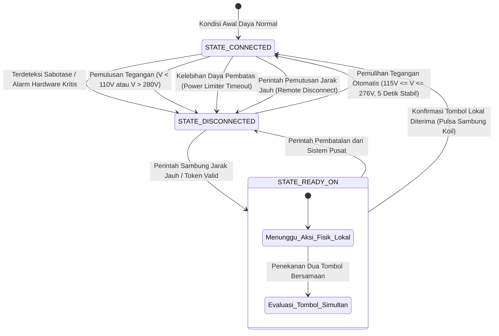

# 3.3 Desain Perangkat Lunak dan Firmware

Mengacu pada metodologi perancangan sistem rekayasa elektro *Design for Electrical and Computer Engineers* (Ford & Coulston, 2008), arsitektur perangkat lunak dan *firmware* menjembatani model perilaku dinamis (*statechart* dan *flowchart*) dengan perangkat keras mikrokontroler. Desain *firmware* mengadopsi sistem operasi waktu nyata berbasis prioritas preemtif (*Real-Time Operating System* / FreeRTOS) yang dieksekusi pada *platform* Host Microcontroller 32-bit ARM Cortex-M33 (STM32U585/STM32U575). Arsitektur perangkat lunak dipartisi ke domain eksekusi terpisah dengan tujuan mendukung pemenuhan tenggat waktu, pemrosesan kriptografi, efisiensi konsumsi daya, dan pemisahan metrologi legal mengacu pada WELMEC Guide 7.1:2021 (*Software Guide Measuring Instruments Directive*).

Arsitektur perangkat lunak disusun dengan menerapkan prinsip pemisahan tanggung jawab (*Separation of Concerns*) dan independensi perangkat keras (*Hardware Abstraction*). Logika komputasi aplikasi, pemrosesan transaksi legal, pengawasan sabotase, serta antarmuka pengguna dipisahkan secara tegas dari akses langsung ke register perangkat keras fisik melalui lapisan abstraksi perangkat keras (*Hardware Abstraction Layer* / HAL) dan *Board Support Package* (BSP). Pendekatan modular ini menjamin bahwa seluruh algoritma kendali dan logika penegakan regulasi bersifat portabel dan dapat diverifikasi secara mandiri.

Dalam hierarki sistem Smart Meter 3-Fasa, lapisan aplikasi inti dan antarmuka pengguna (*Application Core & HMI*) memegang peranan krusial sebagai pengorkestrator utama operasional meter. Lapisan ini secara kontinu mengoordinasikan penerimaan data pengukuran energi listrik terkalibrasi, menegakkan perlindungan terhadap berbagai upaya sabotase fisik maupun kelistrikan, mengendalikan mekanisme pembatas beban melalui relai pemutus daya, memproses basis data profil beban (*load profile*) 15-menitan (ER-02/ER-04), mencatat pembekuan tagihan bulanan (*billing snapshot*) selama 12 bulan terakhir (SPLN Butir 6.13), serta mengeksekusi prosedur penyelamatan data darurat saat pasokan listrik padam (*Last-Gasp Energy Flush* dalam jendela waktu 150 ms dengan dukungan cadangan energi superkapasitor 1,5 F). Seluruh fungsionalitas ini dirancang secara terpadu guna memastikan kepatuhan menyeluruh terhadap standar nasional **SPLN D3.006: 2021** (Spesifikasi Meter Statip Fase Tiga Prabayar dan Pascabayar) serta standar internasional **IEC 62056 (DLMS/COSEM)**.

Pembahasan pada subbab ini disajikan ke dalam empat bagian utama sebagai berikut:
1. Alokasi tugas FreeRTOS, penataan prioritas, mekanisme komunikasi antar-tugas (IPC), dan verifikasi keterjadwalan matematis berbasis teorema *Rate-Monotonic Scheduling* (RMS).
2. Protokol komunikasi dan pemformatan bingkai pesan pada bus antarmuka periferal (SPI), profil jaringan DLMS/COSEM HDLC dan TCP/UDP, serta jabat tangan antarmuka port optik lokal.
3. Logika deteksi sabotase (*tamper*), klasifikasi alarm perangkat keras internal, serta *state machine* kontrol relai pemutus beban dan prosedur keselamatan penyambungan kembali (*READY ON*).
4. Tata letak tampilan layar antarmuka pengguna lokal (HMI) sesuai format standar SPLN Gambar 4 serta *Finite State Machine* (FSM) navigasi tampilan dan fitur pembacaan saat listrik padam (*Off-Power Wake-Up*).

---

### 3.3.1 Alokasi Tugas Real-Time Operating System (FreeRTOS) dan Analisis Penjadwalan

Sistem operasi waktu nyata FreeRTOS digunakan sebagai pengelola alokasi sumber daya pemroses pada mikrokontroler utama. Seluruh proses perangkat lunak dibagi ke dalam empat tugas (*tasks*) mandiri yang berjalan bersamaan dan dikoordinasikan menggunakan skema penjadwalan preemtif berbasis prioritas statis (*Fixed-Priority Preemptive Scheduling*). Pembagian tugas ini bertujuan untuk memastikan setiap fungsi sistem memperoleh alokasi waktu eksekusi yang sesuai dengan tingkat kekritisan operasinya.

Alokasi tugas, tingkatan prioritas, periode kedatangan proses ($T_i$), kapasitas memori *stack*, serta deskripsi fungsi dari masing-masing tugas ditunjukkan pada Tabel 3.3.1.

**Tabel 3.3.1 Matriks Alokasi Tugas FreeRTOS Smart Meter 3-Fasa**

| Nama Tugas | Prioritas | Periode ($T_i$) | Alokasi Stack | Fungsi Utama |
| :--- | :---: | :---: | :---: | :--- |
| *Task_Tamper_Emergency* | 4 | $100\text{ ms}$ | $1\text{ KB}$ | Deteksi sabotase fisik/elektrikal, pemutusan relai darurat, dan notifikasi *Last-Gasp*. |
| *Task_Metrology_Profiling* | 3 | $1000\text{ ms}$ | $2\text{ KB}$ | Akumulasi energi, evaluasi pembatas daya (*Power Limiter*), dan profil beban 15 menit. |
| *Task_DLMS_Server* | 2 | $50\text{ ms}$ | $4\text{ KB}$ | Layanan komunikasi DLMS/COSEM (port optik & seluler) serta enkripsi data. |
| *Task_UI_Display* | 1 | $500\text{ ms}$ | $2\text{ KB}$ | Pembaruan layar LCD, navigasi menu, dan perputaran tampilan otomatis. |

Selain keempat tugas aplikasi tersebut, FreeRTOS mengeksekusi *IDLE Task* pada Prioritas 0. Apabila seluruh tugas aplikasi berada dalam kondisi terblokir (*Blocked*) saat menunggu kejadian interupsi atau pewaktu, penjadwal secara otomatis mengaktifkan fitur hemat energi (*Tickless Idle Mode*). Fitur ini menghentikan osilator frekuensi tinggi dan menempatkan mikrokontroler pada mode konsumsi daya rendah (*Low-Power Sleep* atau *Stop 2*) untuk menghemat cadangan energi sistem.

Keterjadwalan deterministik dari seluruh tugas FreeRTOS dievaluasi menggunakan teorema batas atas *Rate-Monotonic Scheduling* (RMS). Pada sistem waktu nyata dengan $n$ tugas periodik independen di mana tenggat waktu penyelesaian sama dengan periode kedatangan tugas ($D_i = T_i$), kondisi batas pemanfaatan prosesor agar seluruh proses terjamin selesai sebelum tenggat waktunya dinyatakan melalui persamaan:

$$U = \sum_{i=1}^{n} \frac{C_i}{T_i} \le n \cdot \left( 2^{1/n} - 1 \right)$$

Di mana $U$ merupakan faktor pemanfaatan prosesor total (*Processor Utilization Factor*), $C_i$ menyatakan waktu eksekusi terburuk (*Worst-Case Execution Time* / WCET) dari tugas $i$, $T_i$ adalah periode kedatangan tugas $i$, dan $n$ merupakan jumlah tugas periodik aktif. Untuk sistem dengan $n = 4$ tugas, batas teoretis keterjadwalan RMS dihitung sebagai berikut:

$$U_{\text{bound}} = 4 \cdot \left( 2^{1/4} - 1 \right) \approx 4 \cdot (1{,}1892 - 1) = 0{,}7568 \quad (75{,}68\%)$$

Pengukuran nilai WCET dilakukan pada mikrokontroler Host yang beroperasi pada frekuensi *clock* sistem $160\text{ MHz}$ dengan akselerator instruksi dan data *cache* (ICACHE dan DCACHE) aktif. Hasil pengukuran dan analisis pemanfaatan komputasi untuk masing-masing tugas disajikan pada Tabel 3.3.2.

**Tabel 3.3.2 Analisis Pemanfaatan Prosesor (WCET) pada Frekuensi 160 MHz**

| No | Nama Tugas | Periode ($T_i$) | WCET ($C_i$) | Rasio Utilisasi ($U_i = C_i / T_i$) | Evaluasi Beban Komputasi |
| :---: | :--- | :---: | :---: | :---: | :--- |
| 1 | *Task_Tamper_Emergency* | $100\text{ ms}$ | $1{,}85\text{ ms}$ | $0{,}0185$ ($1{,}85\%$) | Filter digital masukan sensor, evaluasi 9 kondisi sabotase, dan pembangkitan pulsa koil relai. |
| 2 | *Task_Metrology_Profiling* | $1000\text{ ms}$ | $14{,}20\text{ ms}$ | $0{,}0142$ ($1{,}42\%$) | Perhitungan tarif ToU 8 zona, kalkulasi deviasi arus asimetris, pembaruan data MD, dan komputasi CRC-16. |
| 3 | *Task_DLMS_Server* | $50\text{ ms}$ | $6{,}40\text{ ms}$ | $0{,}1280$ ($12{,}80\%$) | Penguraian bingkai pesan HDLC, dekripsi dan verifikasi otentikasi AES-128 GCM, serta serialisasi data OBIS. |
| 4 | *Task_UI_Display* | $500\text{ ms}$ | $18{,}50\text{ ms}$ | $0{,}0370$ ($3{,}70\%$) | Kompilasi *frame buffer* numerik, konversi karakter font matriks, dan transfer data antarmuka layar. |
| **Total** | **Pemanfaatan Total ($U$)** | — | — | **$0{,}1977$ ($19{,}77\%$)** | **Margin Cadangan Komputasi CPU = $80{,}23\%$** |

Berdasarkan hasil perhitungan tersebut, faktor pemanfaatan prosesor total diperoleh sebesar $U = 19{,}77\%$. Nilai ini berada jauh di bawah batas teoretis keterjadwalan RMS sebesar $U_{\text{bound}} = 75{,}68\%$. Dengan demikian, sistem terbukti secara matematis bersifat deterministik, stabil, dan terbebas dari risiko kegagalan tenggat waktu (*deadline miss*). Cadangan kapasitas prosesor sebesar $80{,}23\%$ dimanfaatkan untuk penanganan rutin layanan interupsi perangkat keras (*Interrupt Service Routines* / ISR) serta eksekusi transisi mode daya rendah.

Sinkronisasi dan pertukaran data antar-tugas dikelola menggunakan mekanisme komunikasi antar-proses (*Inter-Process Communication* / IPC) yang aman dari benturan akses serempak (*thread-safe*):
1. Antrean Pesan (*Message Queue*): Digunakan untuk meneruskan notifikasi kejadian sabotase secara asinkron dari konteks ISR atau tugas darurat menuju tugas server komunikasi dan tugas tampilan antarmuka. Antrean dirancang dengan kapasitas penyangga 10 elemen pesan berstruktur padat yang memuat penanda waktu kejadian, kode klasifikasi sabotase, dan status pemulihan.
2. *Mutex* Pewarisan Prioritas (*Priority Inheritance Mutex*): Diterapkan untuk melindungi variabel data pengukuran bersama dan parameter konfigurasi legal. Mekanisme pewarisan prioritas ini mengeliminasi terjadinya pembalikan prioritas tanpa batas (*Unbounded Priority Inversion*), sehingga tugas berprioritas tinggi tidak terhambat tanpa batas waktu saat mengakses data pengukuran yang sedang digunakan oleh tugas lain.
3. Pengawas Perangkat Keras Eksternal (*External Watchdog Supervisor*): Pengawasan integritas eksekusi perangkat lunak dilakukan menggunakan sirkuit *watchdog timer* eksternal. Setiap tugas diwajibkan melakukan konfirmasi keaktifan secara periodik. Sinyal penyegaran (*toggle*) menuju pin sirkuit pengawas hanya dibangkitkan apabila seluruh tugas terbukti aktif dan beroperasi normal. Apabila salah satu tugas mengalami kegagalan atau kebuntuan (*deadlock*), sinyal penyegaran terhenti dan sirkuit pengawas akan melakukan inisialisasi ulang (*hard reset*) pada mikrokontroler dalam waktu $1{,}6\text{ detik}$.

---

### 3.3.2 Protokol Komunikasi dan Pemformatan Bingkai Pesan

Arsitektur komunikasi data pada Smart Meter 3-Fasa mencakup komunikasi bus internal antar-sirkuit terpadu pada papan sistem serta komunikasi antarmuka eksternal untuk pengiriman data telemetri menuju sistem sentral dan pembacaan lokal.

#### 3.3.2.1 Protokol Bus SPI

Komunikasi data antara mikrokontroler utama (Host MCU) dengan sirkuit terpadu penginderaan metrologi (AFE) diimplementasikan melalui antarmuka *Serial Peripheral Interface* (SPI) berkecepatan tinggi:
* Topologi Bus: Menggunakan konfigurasi *Master-Slave* empat kawat (`SCK`, `MOSI`, `MISO`, `CS`) dengan frekuensi kerja $f_{\text{SCK}} = 10\text{ MHz}$, beroperasi pada SPI Mode 0 ($\text{CPOL}=0, \text{CPHA}=0$).
* Format Bingkai Transaksi 32-Bit: Setiap siklus transmisi diawali dengan pengiriman 16-bit alamat register dan kode instruksi (Bit 15 mendefinisikan operasi Baca atau Tulis), yang kemudian diikuti oleh transfer 16-bit atau 32-bit data muatan (*payload*).
* Integritas Sinyal dan Aliran Data: Pembacaan data gelombang tegangan dan arus sesaat berkecepatan tinggi (8 kSPS) serta data register energi dilindungi oleh mekanisme verifikasi CRC-16 ANSI ($x^{16} + x^{15} + x^2 + 1$) untuk mendeteksi potensi distorsi sinyal atau gangguan derau elektromagnetik pada lintasan transmisi PCB.

#### 3.3.2.2 Profil DLMS/COSEM HDLC dan Pembungkus TCP/UDP

Pertukaran data transaksi dan operasional dengan Head-End System (HES) PLN maupun perangkat pembaca lapangan mengadopsi standar internasional **IEC 62056 (DLMS/COSEM)**:
* Lapisan Fisik dan Tautan Data: Mendukung profil HDLC *Direct Local Port* (IEC 62056-46) untuk komunikasi serial asinkron pada port optik, serta profil *TCP/UDP-Wrapper* (IEC 62056-47) untuk komunikasi jarak jauh melalui modul modem seluler (GSM/GPRS/4G).
* Format Enkapsulasi A-XDR: Seluruh parameter operasional dienkapsulasi ke dalam struktur data *Adapted Basic Encoding Rules* (A-XDR). Parameter pengukuran, status operasional, serta catatan kejadian dipetakan ke dalam skema penamaan logis *Object Identification System* (OBIS) sebagaimana disajikan pada Tabel 3.3.3.
* Keamanan Kriptografi: Mengimplementasikan DLMS *Security Suite 0* berbasis algoritma enkripsi simetris AES-GCM-128 (*Galois/Counter Mode*). Skema ini menjamin kerahasiaan (*confidentiality*), integritas data (*data integrity*), serta autentikasi dua arah (*mutual authentication*) guna melindungi sistem dari manipulasi transaksi dan akses perintah ilegal.

**Tabel 3.3.3 Pemetaan Objek OBIS dan Format Data Transaksi DLMS/COSEM**

| Parameter Kelistrikan dan Status Sistem | Kode Identifikasi OBIS | Tipe Kelas COSEM | Format Data A-XDR | Satuan dan Skalar |
| :--- | :---: | :---: | :---: | :---: |
| Energi Aktif Impor Total ($+A$) | `1.0.1.8.0.255` | Register (Kelas 3) | Bilangan Bulat 32-bit | $10^{-3}\text{ kWh}$ (Wh) |
| Energi Aktif Ekspor Total ($-A$) | `1.0.2.8.0.255` | Register (Kelas 3) | Bilangan Bulat 32-bit | $10^{-3}\text{ kWh}$ (Wh) |
| Energi Reaktif Impor ($+R$) | `1.0.3.8.0.255` | Register (Kelas 3) | Bilangan Bulat 32-bit | $10^{-3}\text{ kvarh}$ (varh) |
| Energi Reaktif Ekspor ($-R$) | `1.0.4.8.0.255` | Register (Kelas 3) | Bilangan Bulat 32-bit | $10^{-3}\text{ kvarh}$ (varh) |
| Tegangan Fasa RMS ($V_R, V_S, V_T$) | `1.0.32.7.0.255`, `52`, `72` | Register (Kelas 3) | Bilangan Bulat 16-bit | $10^{-1}\text{ V}$ (dV) |
| Arus Fasa RMS ($I_R, I_S, I_T$) | `1.0.31.7.0.255`, `51`, `71` | Register (Kelas 3) | Bilangan Bulat 32-bit | $10^{-3}\text{ A}$ (mA) |
| Arus Kawat Netral RMS ($I_N$) | `1.0.91.7.0.255` | Register (Kelas 3) | Bilangan Bulat 32-bit | $10^{-3}\text{ A}$ (mA) |
| Faktor Daya Total ($\cos \phi$) | `1.0.13.7.0.255` | Register (Kelas 3) | Bilangan Bulat 16-bit | $10^{-3}$ (*Permille*) |
| Frekuensi Sistem Listrik ($f$) | `1.0.14.7.0.255` | Register (Kelas 3) | Bilangan Bulat 16-bit | $10^{-2}\text{ Hz}$ (centi-Hz) |
| Status Pemutus Beban (*Relay State*) | `0.0.96.3.10.255` | Disconnect Control (Kelas 70)| Boolean / Enumerasi | 0 = Terbuka, 1 = Tertutup |
| Catatan Riwayat Sabotase (*Tamper Log*)| `0.0.99.98.0.255` | Profile Generic (Kelas 7) | Larik Struktur Kompak (72B)| Waktu, Vektor, Status |

#### 3.3.2.3 Protokol Jabat Tangan Port Optik Lokal

Antarmuka port optik inframerah depan disediakan untuk kebutuhan konfigurasi parameter, audit transaksi, dan pengujian meter di lapangan menggunakan perangkat genggam (*Handheld Unit* / HHU). Protokol komunikasi menerapkan prosedur jabat tangan sesuai standar **IEC 62056-21 Mode E**:
1. Inisiasi Sesi pada Kecepatan Rendah: Perangkat HHU mengirimkan perintah pembuka sesi berupa string karakter `/?!<CR><LF>` pada kecepatan awal $300\text{ bps}$ dengan format 7-bit data, paritas genap (*even parity*), dan 1 stop bit.
2. Identifikasi Perangkat: Smart Meter memproses perintah tersebut dan mengirimkan respons bingkai identifikasi berupa `/LEN5\2ALLIN-METER<CR><LF>`.
3. Negosiasi dan Perubahan Laju Baud (*Baud Rate Switching*): Perangkat HHU memverifikasi identitas meter dan mengirimkan persetujuan protokol yang meminta peningkatan kecepatan komunikasi menuju $9600\text{ bps}$.
4. Transisi Sesi Protokol Biner: Setelah konfirmasi diterima oleh kedua belah pihak, kanal komunikasi secara otomatis beralih menuju sesi transfer data berkecepatan tinggi menggunakan protokol biner DLMS/COSEM HDLC.

---

### 3.3.3 Logika Tamper dan Kontrol Relai

Subsistem pengamanan mengintegrasikan fungsi pengawasan terhadap upaya sabotase eksternal, pemantauan integritas internal perangkat keras, serta kendali relai pemutus beban utama guna memenuhi persyaratan **SPLN D3.006: 2021 Butir 10.3 dan Butir 12.3**.

Sistem memantau 9 vektor kondisi sabotase eksternal dan 8 alarm kegagalan internal secara paralel. Setiap indikasi kejadian memicu respons terstandardisasi berupa: pembukaan kontak relai utama (*trip*), pengaktifan lampu indikator LED Kuning Sabotase, pencatatan data kejadian ke dalam memori non-volatile FIFO dengan kapasitas minimal 30 rekaman, serta penayangan kode peringatan pada layar antarmuka. Matriks klasifikasi kondisi sabotase dan tindakan sistem dirinci pada Tabel 3.3.4.

**Tabel 3.3.4 Matriks Klasifikasi Sabotase dan Tindakan Sistem (SPLN D3.006: 2021 Tabel 6)**

| No | Vektor Sabotase Eksternal | Kondisi Logika Pemicu | Status Relai | Indikasi Layar | Indikator LED Kuning | Ambang Waktu Evaluasi |
| :---: | :--- | :--- | :---: | :---: | :---: | :---: |
| 1 | Tutup Meter Dibuka | Sensor mekanik tutup meter terbuka | Membuka (Trip) | Teks `"RUSAK"` | Tidak Aktif | Seketika ($< 10\text{ ms}$) |
| 2 | Tutup Terminal Dibuka | Sensor mekanik tutup terminal terbuka | Membuka (Trip) | Teks `"PERIKSA"`, `"ERR20"` | Aktif | $100\text{ ms}$ (Filter *Debounce*) |
| 3 | Urutan Fasa Terbalik | Urutan fasa terdeteksi $R \rightarrow T \rightarrow S$ | Membuka (Trip) | Teks `"PERIKSA"`, `"ERR21"` | Aktif | $1000\text{ ms}$ kontinu |
| 4 | Pengawatan Silang | Arus fasa tidak berkorelasi dengan tegangan | Membuka (Trip) | Teks `"PERIKSA"`, `"ERR22"` | Aktif | $3000\text{ ms}$ verifikasi arah |
| 5 | Kawat Netral Putus/Hilang | Arus netral terdeteksi saat tegangan hilang | Tetap Menutup | Teks `"PERIKSA"`, `"ERR23"` | Aktif | Pengukuran daya parasitik |
| 6 | Tegangan Hilang 1/2 Fasa | Tegangan fasa $< 110\text{ V}$ saat arus mengalir | Membuka (Trip) | Teks `"PERIKSA"`, `"ERR24"` | Aktif | $3000\text{ ms}$ kontinu |
| 7 | Induksi Medan Magnet | Sensor medan magnet mendeteksi fluks $>300\text{ mT}$ | Tetap Menutup | Teks `"PERIKSA"`, `"ERR25"` | Tidak Aktif | $3000\text{ ms}$ durasi kontinu |
| 8 | Arus Balik (*Reverse Power*) | Daya aktif fasa bernilai negatif ($P < -50\text{ W}$) | Tetap Menutup | Teks `"REVERSE"`, `"ERR26"` | Aktif | $2000\text{ ms}$ kontinu |
| 9 | Faktor Daya Rendah (Kuadran 4) | Faktor daya kapasitif $\cos \phi < 0{,}85$ pada beban | Tetap Menutup | Teks `"PERIKSA"`, `"ERR27"` | Aktif | $5000\text{ ms}$ kontinu |

Selain pengawasan terhadap faktor eksternal, kondisi operasional internal perangkat keras dipantau secara mandiri mengacu pada ketentuan **SPLN D3.006: 2021 Tabel 4**:
* `ERR00`: Kerusakan pada memori Flash program atau data (*checksum mismatch*), memicu pembukaan relai dan pengaktifan LED kuning.
* `ERR01`: Kegagalan pada memori kerja RAM berdasarkan pengujian pola bit March C-, memicu pembukaan relai dan pengaktifan LED kuning.
* `ERR02`: Gangguan atau penghentian osilator waktu nyata (*RTC Stop/Loss*), memicu pembukaan relai dan pengaktifan LED kuning.
* `ERR03`: Penurunan tegangan baterai cadangan di bawah ambang batas ($V_{\text{BAT}} < 2{,}7\text{ V}$), memicu pengaktifan LED kuning.
* `ERR04`: Ketidaknormalan pada pemrosesan instruksi mikroprosesor, memicu pembukaan relai dan pengaktifan LED kuning.
* `ERR05`: Kegagalan pengambilan sampel data konverter analog-ke-digital pada AFE, memicu pembukaan relai dan pengaktifan LED kuning.
* `ERR06`: Kerusakan atau pelepasan fisik pada superkapasitor cadangan daya, memicu pengaktifan LED kuning.
* `ERR07`: Ketidaksesuaian status umpan balik mekanis kontak relai terhadap sinyal kendali koil, memicu pengaktifan LED kuning.

Mekanisme pemutusan beban utama dikendalikan melalui relai kontrol kontak kering (*dry contact relay*) berkapasitas 240 VAC / 2 A yang terhubung ke koil *shunt trip* pemutus sirkuit eksternal (MCCB/ACB). Sinyal kendali pemutus dibangkitkan secara terisolasi melalui pin keluaran digital `RELAY_TRIP` (PC8) dengan durasi pulsa terkalibrasi $100\text{ ms}$ guna memicu pelepasan mekanis MCCB seraya mencegah disipasi daya termal berlebih pada koil. Kondisi aktual kontak pemutus dipantau secara langsung melalui pin masukan umpan balik `RELAY_STATUS` (PC7 / EXTI7) untuk mendeteksi kegagalan mekanis sistem (*ERR07*).

Perilaku operasional pemutus beban diatur menggunakan *Finite State Machine* (FSM) yang memiliki 3 status kerja utama sesuai dengan ketentuan **SPLN D3.006: 2021 Tabel 5 Butir 12 & 13**:

Deskripsi operasional dari masing-masing status pemutus beban adalah sebagai berikut:
1. `STATE_CONNECTED` (Relai Tersambung / Operasi Normal): Kontak relai tertutup dan menyalurkan daya listrik menuju beban pelanggan. Algoritma proteksi tegangan secara kontinu memantau batas aman tegangan pasokan (SPLN Butir 10.3 Tabel 9). Relai diperintahkan membuka apabila tegangan fasa turun di bawah $110{,}0\text{ V}$ (*Under-Voltage Cut-Off*) atau melonjak melebihi $280{,}0\text{ V}$ (*Over-Voltage Cut-Off*). Selain itu, fungsi pembatas beban (*Power Limiter*) memantau daya aktif sesaat terhadap batas kontrak langganan $P_{\text{limit}}$; apabila daya terukur melampaui batas selama $5\text{ detik}$, relai secara otomatis membuka.
2. `STATE_DISCONNECTED` (Relai Terbuka / Terisolasi): Instalasi pelanggan terputus dari jaringan listrik. Pada pemutusan yang diakibatkan oleh kondisi tegangan pasokan abnormal, sistem menjalankan prosedur penyambungan kembali secara otomatis (*Auto-Reclose*). Kontak relai akan menutup kembali secara mandiri hanya jika tegangan pasokan telah stabil dalam rentang histeresis aman ($115{,}0\text{ V} \le V \le 276{,}0\text{ V}$) selama sekurang-kurangnya $5\text{ detik}$ berturut-turut. Pada pemutusan akibat habis kredit, tindakan sabotase, atau perintah administratif dari HES, relai dipertahankan terkunci pada status terbuka.
3. `STATE_READY_ON` (Status Siaga Sambung Sesuai Regulasi Keselamatan): Merupakan mekanisme keselamatan wajib SPLN untuk mencegah bahaya kebakaran atau kecelakaan kejut listrik pada instalasi pelanggan saat daya listrik dinyalakan kembali dari jarak jauh. Ketika Smart Meter menerima perintah penyambungan kembali (*Remote Reconnect*) atau token aktivasi yang valid, relai dilarang keras langsung menutup secara otomatis. Sistem beralih menuju status `STATE_READY_ON`, layar antarmuka menampilkan indikasi teks berkedip `"READY ON"`, dan sistem menunggu konfirmasi fisik langsung pada meter. Relai baru akan diperintahkan menutup setelah pengguna menekan kedua tombol navigasi meter secara simultan (Tombol Atas ▲ dan Tombol Bawah ▼ ditekan bersamaan selama sekurang-kurangnya $1\text{ detik}$).

---

### 3.3.4 Tata Letak Tampilan Layar HMI Lokal dan FSM Navigasi

Sistem antarmuka pengguna lokal (*Human-Machine Interface* / HMI) mengadopsi format tampilan terstandardisasi sesuai dengan ketentuan **SPLN D3.006: 2021 Lampiran E (Gambar 4, Tabel E.1, dan Tabel E.2)**. Bidang tampilan visual disusun secara terstruktur ke dalam 3 zona informasi utama:
1. Zona Baris Status Atas (*Status Header Bar*): Berisi indikator simbol fasa `[R]`, `[S]`, `[T]` yang aktif apabila tegangan fasa terukur $> 110\text{ V}$; indikator arah aliran daya impor (`IMP` / $+P$) atau ekspor (`EXP` / $-P$); penunjuk status kontak pemutus `[RELAI ON]`, `[RELAI OFF]`, atau `[READY ON]`; serta ikon peringatan `[!]` apabila terdapat catatan sabotase aktif dan indikator grafis kapasitas daya baterai cadangan.
2. Zona Nilai Utama (*Primary Value Area*): Menampilkan nilai numerik parameter yang sedang dipilih menggunakan font matriks proporsional berukuran $11 \times 18$ piksel agar dapat diobservasi dengan jelas dari jarak pandang sekurang-kurangnya 2 meter, disertai penunjuk simbol satuan pengukuran standar (`V`, `A`, `W`, `var`, `VA`, `kWh`, `kvarh`, `Hz`, atau `-` untuk faktor daya).
3. Zona Keterangan Bawah (*Bottom Description Footer*): Menampilkan nomor urut halaman parameter (indeks 01 s.d. 39) diikuti deskripsi teks parameter bersangkutan dalam bahasa Indonesia baku mengacu pada Lampiran E SPLN.

Sistem mengelola total **39 halaman tampilan parameter operasional standar** (sesuai SPLN D3.006: 2021 Lampiran E Tabel E.1 dan Tabel E.2) serta **2 halaman notifikasi sistem khusus**, sebagaimana dirinci pada Tabel 3.3.5. Seluruh 39 halaman parameter operasional dapat diakses secara berurutan pada mode penelusuran manual menggunakan tombol navigasi, di mana **15 halaman parameter utama di antaranya diputar secara periodik pada siklus otomatis (*auto-scroll carousel*)** setiap 5 detik saat meter tidak menerima interaksi tombol.

**Tabel 3.3.5 Matriks Halaman Layar HMI Smart Meter 3-Fasa (SPLN D3.006: 2021 Lampiran E)**

| No Hal | Parameter Besaran yang Ditampilkan | Register SPLN | Satuan Teknis | Mode Penayangan HMI |
| :---: | :--- | :---: | :---: | :--- |
| 01 | Nomor Identitas Pelanggan PLN (12-Digit) | `IDPEL` | — | Siklus Otomatis (Halaman Awal) & Manual |
| 02 | Nomor Identifikasi Pabrik Smart Meter | `METERID` | — | Penelusuran Manual |
| 03 | Total Daya Aktif Kirim / Ekspor | `P_EXP` | kW | Penelusuran Manual |
| 04 | Total Daya Aktif Terima / Impor | `P_IMP` | kW | Penelusuran Manual |
| 05 | Total Daya Reaktif Kirim / Ekspor | `Q_EXP` | kvar | Penelusuran Manual |
| 06 | Total Daya Reaktif Terima / Impor | `Q_IMP` | kvar | Penelusuran Manual |
| 07 | Stand Energi Aktif Kirim Tarif 1 (WBP) | `EA_EXP1` | kWh | Siklus Otomatis & Manual |
| 08 | Stand Energi Aktif Kirim Tarif 2 (LWBP1) | `EA_EXP2` | kWh | Siklus Otomatis & Manual |
| 09 | Stand Energi Aktif Kirim Tarif 3 (LWBP2) | `EA_EXP3` | kWh | Siklus Otomatis & Manual |
| 10 | Stand Energi Aktif Kirim Total | `EA_EXP` | kWh | Siklus Otomatis & Manual |
| 11 | Stand Energi Aktif Terima Tarif 1 (WBP) | `EA_IMP1` | kWh | Penelusuran Manual |
| 12 | Stand Energi Aktif Terima Tarif 2 (LWBP1) | `EA_IMP2` | kWh | Penelusuran Manual |
| 13 | Stand Energi Aktif Terima Tarif 3 (LWBP2) | `EA_IMP3` | kWh | Penelusuran Manual |
| 14 | Stand Energi Aktif Terima Total | `EA_IMP` | kWh | Siklus Otomatis & Manual |
| 15 | Stand Energi Reaktif Kirim Total | `ER_EXP` | kvarh | Penelusuran Manual |
| 16 | Stand Energi Reaktif Terima Total | `ER_IMP` | kvarh | Penelusuran Manual |
| 17 | Stand Energi Aktif Total ($EA\_EXP + EA\_IMP$) | `EA_TOT` | kWh | Siklus Otomatis & Manual |
| 18 | Stand Energi Reaktif Penagihan Kompensasi | `ER_BIL` | kvarh | Siklus Otomatis & Manual |
| 19 | Tegangan Listrik Fasa R terhadap Netral ($V_R$) | `UR` | V | Siklus Otomatis & Manual |
| 20 | Tegangan Listrik Fasa S terhadap Netral ($V_S$) | `US` | V | Siklus Otomatis & Manual |
| 21 | Tegangan Listrik Fasa T terhadap Netral ($V_T$) | `UT` | V | Siklus Otomatis & Manual |
| 22 | Sudut Fasa Tegangan $V_R$ (Referensi $0^\circ$) | `Sdt_UR` | Derajat ($^\circ$) | Penelusuran Manual |
| 23 | Sudut Fasa Tegangan $V_S$ terhadap $V_R$ | `Sdt_US` | Derajat ($^\circ$) | Penelusuran Manual |
| 24 | Sudut Fasa Tegangan $V_T$ terhadap $V_R$ | `Sdt_UT` | Derajat ($^\circ$) | Penelusuran Manual |
| 25 | Arus Listrik Fasa R ($I_R$) | `IR` | A | Siklus Otomatis & Manual |
| 26 | Arus Listrik Fasa S ($I_S$) | `IS` | A | Siklus Otomatis & Manual |
| 27 | Arus Listrik Fasa T ($I_T$) | `IT` | A | Siklus Otomatis & Manual |
| 28 | Arus Listrik Kawat Netral ($I_N$) | `IN` | A | Siklus Otomatis & Manual |
| 29 | Sudut Fasa Arus $I_R$ terhadap Tegangan $V_R$ | `Sdt_IR` | Derajat ($^\circ$) | Penelusuran Manual |
| 30 | Sudut Fasa Arus $I_S$ terhadap Tegangan $V_S$ | `Sdt_IS` | Derajat ($^\circ$) | Penelusuran Manual |
| 31 | Sudut Fasa Arus $I_T$ terhadap Tegangan $V_T$ | `Sdt_IT` | Derajat ($^\circ$) | Penelusuran Manual |
| 32 | Faktor Daya Sistem Total ($\cos \phi$) | `PF` | — | Penelusuran Manual |
| 33 | Waktu Kalender dan Jam Real-Time (WIB) | `TIME` | dd-mm-yyyy hh:mm:ss | Penelusuran Manual |
| 34 | Batas Ambang Daya Pembatas Kontrak | `P_LIM` | kW | Penelusuran Manual |
| 35 | Kebutuhan Daya Semu Maksimum Kirim | `S_MAX` | kVA | Penelusuran Manual |
| 36 | Penanda Waktu Kebutuhan Maksimum Kirim | `TS_MAX` | dd-mm-yyyy hh:mm:ss | Penelusuran Manual |
| 37 | Tanggal Penutupan Periode Tagihan | `EoB` | dd-hh | Penelusuran Manual |
| 38 | Nilai *Checksum* Integritas Perangkat Lunak | `CSUM` | Heksadesimal | Penelusuran Manual |
| 39 | Kode Identitas Unit Pengelola Pelayanan PLN | `PLN` | — | Penelusuran Manual |
| 40 | Halaman Peringatan Sabotase (`PERIKSA ERRxx` / `RUSAK`) | `ALARM` | Kode Alarm | Prioritas Interupsi (Tampilan Terkunci) |
| 41 | Halaman Notifikasi Siaga Sambung (`READY ON`) | `RELAY` | Petunjuk Aksi | Prioritas Interupsi (Tampilan Terkunci) |

Alur navigasi antar-halaman pada layar antarmuka diatur menggunakan mesin keadaan (*Finite State Machine* / FSM) dengan model transisi operasional:
1. Mode Perputaran Otomatis (*Auto-Scroll Carousel*): Pada kondisi normal tanpa adanya penekanan tombol fisik oleh pengguna, layar secara periodik memperbarui penayangan 15 halaman operasional utama dengan interval waktu perputaran $5\text{ detik}$ per tampilan.
2. Mode Penelusuran Manual (*Manual Push Button Scroll*): Penekanan salah satu tombol navigasi fisik (Tombol Atas ▲ atau Tombol Bawah ▼) menghentikan perputaran otomatis dan mengunci tampilan pada mode penelusuran manual. Pengguna dapat menelusuri seluruh 39 halaman parameter operasional ke depan maupun ke belakang. Sistem mengaktifkan pewaktu jeda (*inactivity timer*) berdurasi $60\text{ detik}$; apabila tidak ada penekanan tombol lanjutan hingga batas waktu berakhir, tampilan layar secara otomatis kembali ke Mode Perputaran Otomatis.
3. Mode Notifikasi Paksaan (*Forced Alarm Display*): Apabila terdeteksi kondisi sabotase aktif atau status relai berada pada siaga sambung (`READY ON`), FSM membatalkan mode penelusuran dan secara permanen mengunci penayangan pada Halaman 40 (`PERIKSA ERRxx` / `RUSAK`) atau Halaman 41 (`READY ON`) dengan frekuensi kedipan 1 Hz hingga kondisi dipulihkan atau dikonfirmasi.
4. Fitur Pengaktifan Layar Saat Listrik Padam (*Off-Power Wake-Up*): Sesuai ketentuan **SPLN D3.006: 2021 Butir 5.2 Poin 12**, pada saat catu daya padam, superkapasitor dan/atau baterai harus mampu mengaktifkan layar tampilan pada saat penekanan tombol. Penekanan tombol navigasi membangkitkan mikrokontroler dari mode daya rendah *Stop 2*, mengaktifkan konverter catu daya layar selama $10\text{ detik}$, dan menampilkan informasi identitas pelanggan serta stan energi terakhir sebelum mematikan kembali catu daya layar menuju mode daya rendah ($I_{\text{sleep}} < 15\ \mu\text{A}$).
