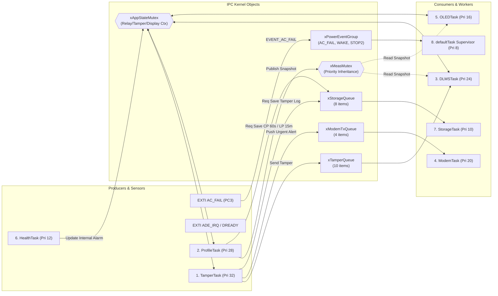
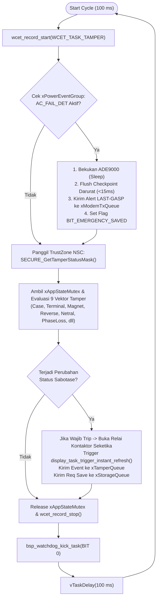
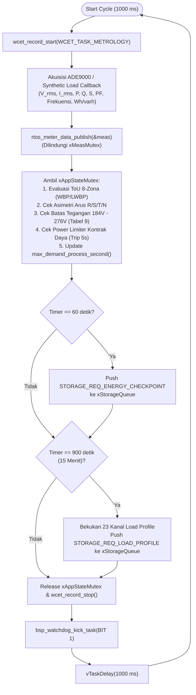
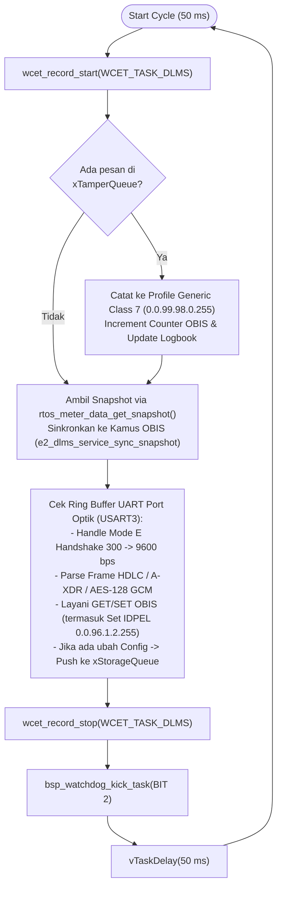
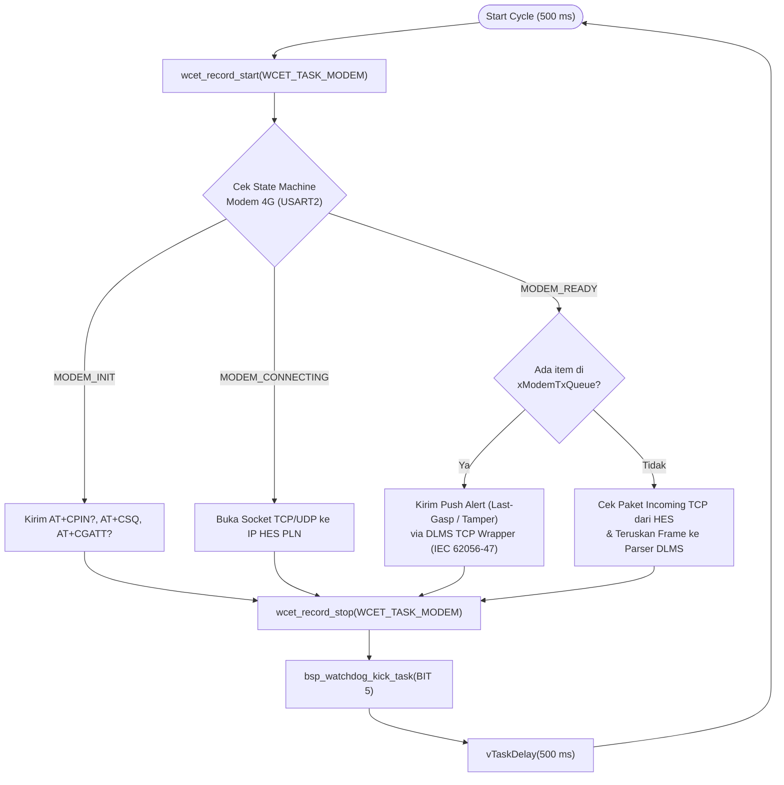
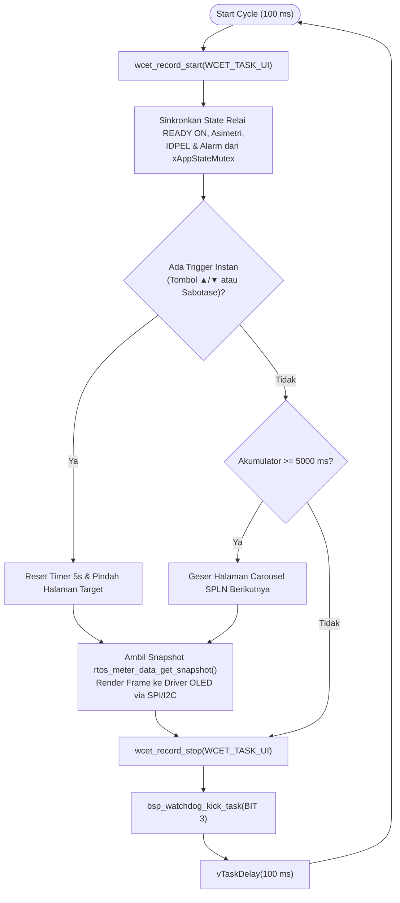
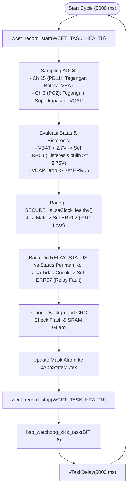
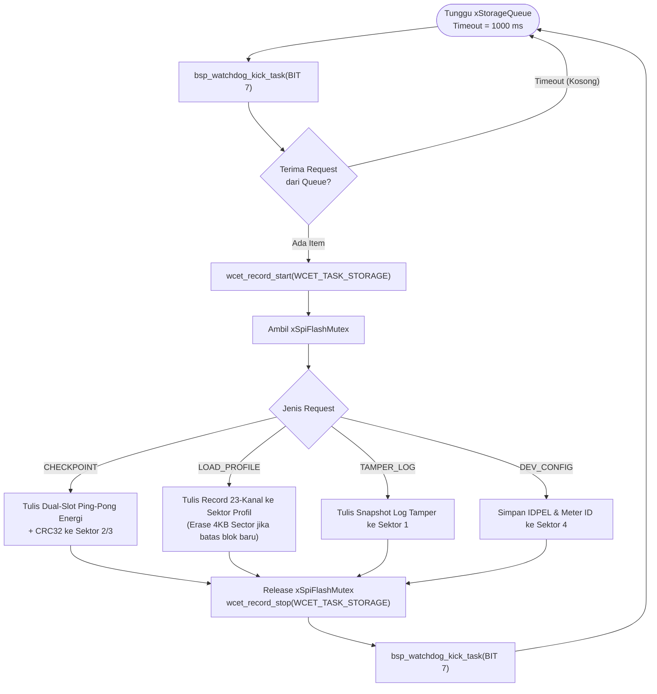
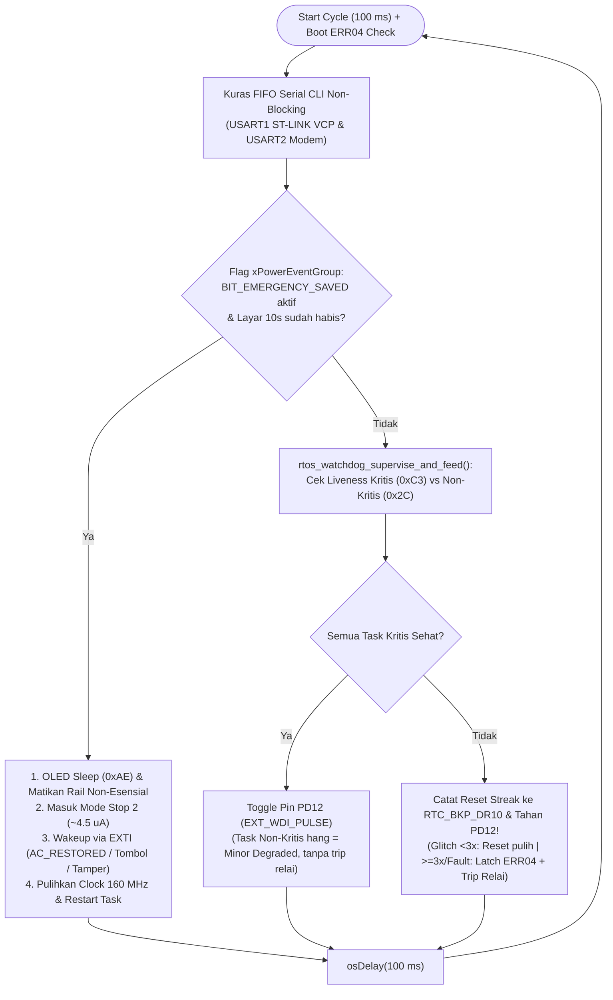

# Perancangan Arsitektur FreeRTOS 8-Task Smart Meter 3-Fasa (STM32U575 + ADE9000)

- **Kode Dokumen:** `DOC-E3-RTOS-008`
- **Tanggal Penyusunan:** 25 November 2026
- **Platform Target:** ARM Cortex-M33 @ 160 MHz (STM32U575VGT6, Domain Non-Secure `ALLIN_NS`)
- **Kernel:** FreeRTOS V11.2.0 (Preemptive Priority-Based, Time-Slicing Active, Tick Rate 1000 Hz)
- **Kepatuhan Standar:** SPLN D3.006: 2021, IEC 62056 (DLMS/COSEM), WELMEC Guide 7.1:2021

---

## 1. Tujuan & Prinsip Desain Pembaruan Arsitektur

Dokumen ini merancang arsitektur final **8-Task FreeRTOS** yang menyempurnakan implementasi awal (5 task) berdasarkan hasil audit kesesuaian kode program terhadap dokumen acuan ([`Desain Sistem.md`](file:///g:/PPPP/ALLIN/Acuan/Desain%20Sistem.md), [`FlowChartE3.drawio`](file:///g:/PPPP/ALLIN/Acuan/FlowChartE3.drawio), dan [`State_DF_D.xml`](file:///g:/PPPP/ALLIN/Acuan/State_DF_D.xml)).

Tiga masalah utama yang diselesaikan oleh perancangan ini:
1. **Menyelamatkan Fungsi yang Tertinggal dari Superloop Lama:** Memindahkan telemetri ADC4 baterai/superkapasitor (`ERR03`/`ERR06`), pemeriksaan clock LSE (`ERR02`), proteksi tegangan jala-jala 184 V–276 V, dan *Maximum Demand* 15-menit agar berjalan aktif di bawah FreeRTOS.
2. **Menghilangkan *Blocking I/O Jitter*:** Memisahkan proses *Sector Erase* SPI Flash W25Q64 (45–100 ms) dan negosiasi AT-Command Modem 4G (ratusan ms–detik) ke dalam *worker task* independen agar metrologi dan port optik tetap deterministik.
3. **Menyatukan *Single Source of Truth* Konteks E3:** Mengkonsolidasikan konteks aplikasi (`tamper_context_t`, `power_relay_context_t`, `load_profile_ctx_t`, `display_context_t`) agar tidak terpecah antara `rtos_tasks.c` dan `e3_meter_app.c`.

---

## 2. Matriks Alokasi Lengkap 8 Task FreeRTOS

Seluruh 8 task berjalan pada domain **Non-Secure** (`configENABLE_TRUSTZONE = 1`, `configRUN_FREERTOS_SECURE_ONLY = 0`). Task yang mengakses periferal aman (*tamper pins*, clock LSE) wajib mengalokasikan *Secure Stack Context* via `portALLOCATE_SECURE_CONTEXT(512)`.

| No | Nama Task | Fungsi Entry Point | Prioritas CMSIS-V2 | Periode / Pemicu ($T_i$) | Stack (Words / Byte) | Estimasi WCET ($C_i$) | Utilisasi CPU ($U_i$) | Bit Watchdog | Status |
| :-: | :--- | :--- | :---: | :---: | :---: | :---: | :---: | :---: | :--- |
| **1** | **`TamperTask`** | `task_tamper_emergency_entry` | **32** *(Realtime)* | $100\text{ ms}$ (Periodik + Event) | 512 / 2048 B | $1{,}85\text{ ms}$ | $1{,}85\%$ | `BIT 0 (0x01)` | Eksisting (+ *Last-Gasp Trigger*) |
| **2** | **`ProfileTask`** | `task_metrology_profiling_entry` | **28** *(High)* | $1000\text{ ms}$ (Periodik) | 768 / 3072 B | $15{,}20\text{ ms}$ | $1{,}52\%$ | `BIT 1 (0x02)` | Eksisting (+ *Voltage Prot, MD, ToU*) |
| **3** | **`DLMSTask`** | `task_dlms_entry` | **24** *(Normal)* | $50\text{ ms}$ (Periodik + UART RX) | 1536 / 6144 B | $6{,}40\text{ ms}$ | $12{,}80\%$ | `BIT 2 (0x04)` | Eksisting (HDLC Optik + OBIS + AES-GCM) |
| **4** | **`ModemTask`** | `task_modem_cellular_entry` | **20** *(BelowNormal4)* | $500\text{ ms}$ + `xModemTxQueue` | 768 / 3072 B | $12{,}00\text{ ms}$ | $2{,}40\%$ | `BIT 5 (0x20)` | **BARU** (AT-Cmd 4G, TCP Wrapper HES) |
| **5** | **`OLEDTask`** | `task_oled128x32_carousel` | **16** *(BelowNormal)* | $100\text{ ms}$ tick (Rotasi $5\text{ s}$) | 768 / 3072 B | $18{,}50\text{ ms}$ / $500\text{ ms}$ eff. | $3{,}70\%$ | `BIT 3 (0x08)` | Eksisting (HMI Carousel SPLN D3.006) |
| **6** | **`HealthTask`** | `task_system_health_entry` | **12** *(Low4)* | $5000\text{ ms}$ (Periodik) | 512 / 2048 B | $2{,}50\text{ ms}$ | $0{,}05\%$ | `BIT 6 (0x40)` | **BARU** (ADC4 `VBAT`/`VCAP`, LSE, Self-Test) |
| **7** | **`StorageTask`** | `task_storage_logger_entry` | **10** *(Low2)* | Blocking `xStorageQueue` ($1000\text{ ms}$ timeout) | 768 / 3072 B | $80{,}00\text{ ms}$ max / $300\text{ s}$ | $0{,}03\%$ | `BIT 7 (0x80)` | **BARU** (Worker Erase/Write W25Q128/64) |
| **8** | **`defaultTask`** | `StartDefaultTask` -> `app_metering_task_loop` | **8** *(Low)* | $100\text{ ms}$ (Periodik) | 768 / 3072 B | $0{,}80\text{ ms}$ | $0{,}80\%$ | *(Supervisor / Bit 4 Legacy)* | Eksisting (CLI, Watchdog PD12, Stop 2) |

---

## 3. Verifikasi Matematika: Penjadwalan CPU & Memori RAM

### 3.1 Analisis *Rate-Monotonic Scheduling* (RMS) & *Response-Time* ($n = 8$)
Batas atas utilisasi teoretis RMS untuk $n = 8$ task periodik:
$$U_{\text{bound}} = 8 \cdot \left(2^{1/8} - 1\right) \approx 8 \cdot (1{,}0905 - 1) = 0{,}7241 \quad (72{,}41\%)$$

Total utilisasi gabungan 8 task:
$$U_{\text{total}} = 1{,}85\% + 1{,}52\% + 12{,}80\% + 2{,}40\% + 3{,}70\% + 0{,}05\% + 0{,}13\% + 0{,}80\% = \mathbf{23{,}25\%}$$

* **Margin Cadangan CPU:** $100\% - 23{,}25\% = \mathbf{76{,}75\%}$ (jauh di bawah batas RMS $72{,}41\%$).
* **Catatan Khusus Prioritas `DLMSTask` vs `TamperTask`/`ProfileTask`:** Sesuai aturan *Criticality-Monotonic* (WELMEC 7.1), keselamatan sabotase (`TamperTask`, 32) dan metrologi legal (`ProfileTask`, 28) diberi prioritas lebih tinggi daripada komunikasi (`DLMSTask`, 24) meskipun `DLMSTask` memiliki periode $50\text{ ms}$. Berdasarkan *Response-Time Analysis* pada *critical instant* terburuk, jumlah WCET prioritas lebih tinggi adalah $1{,}85\text{ ms} + 15{,}20\text{ ms} + 6{,}40\text{ ms} = 23{,}45\text{ ms} < 50\text{ ms}$, sehingga `DLMSTask` dijamin **tidak pernah melewati deadline $50\text{ ms}$-nya**.

### 3.2 Audit Kapasitas Heap RAM FreeRTOS (`configTOTAL_HEAP_SIZE = 49152 B`)
Mengacu [`FreeRTOSConfig.h`](file:///g:/PPPP/ALLIN/NonSecure/Core/Inc/FreeRTOSConfig.h#L189), kapasitas Heap FreeRTOS adalah **48 KB (49.152 byte)** dari total 512 KB Non-Secure RAM STM32U585VIT6:

| Komponen Alokasi Memori | Ukuran |
| :--- | :---: |
| Total Stack 8 Task Aplikasi (`512+768+1536+768+768+512+768+768` words) | $25.600\text{ B}$ |
| Stack FreeRTOS Kernel (`TimerTask` 128w + `IdleTask` 128w) | $1.024\text{ B}$ |
| Task Control Blocks (10 TCB × ~140 B) | $1.400\text{ B}$ |
| Buffer 3 Message Queue + 3 Mutex + 1 EventGroup | $\sim 2.000\text{ B}$ |
| **Total Konsumsi Heap FreeRTOS** | **$\sim 30.024\text{ B}$ ($29{,}3\text{ KB}$)** |
| **Sisa Ruang Heap Cadangan (*Safety Margin*)** | **$\sim 19.128\text{ B}$ ($18{,}7\text{ KB}$ / $39\%$)** |

> **Catatan TrustZone:** Alokasi `portALLOCATE_SECURE_CONTEXT(256)` ($1.024\text{ B}$ per task — jauh di atas kedalaman stack NSC $\le 150\text{ B}$) mengambil memori dari *Secure RAM Pool* `10 KB` (`secureconfigMAX_SECURE_CONTEXTS = 8`) di `ALLIN_S`, sehingga tidak mengurangi kapasitas 48 KB heap Non-Secure di atas dan muat penuh untuk seluruh task pemanggil NSC.

---

## 4. Arsitektur Inter-Task Communication (IPC)



### Daftar Objek IPC yang Didefinisikan:
1. **`xTamperQueue` (Kapasitas: 10 × `tamper_event_msg_t`):** Menyalurkan event sabotase dari `TamperTask`/EXTI ISR ke `DLMSTask` untuk dicatat ke logbook Generic Profile Class 7 (`0.0.99.98.0.255`).
2. **`xStorageQueue` (Kapasitas: 8 × `storage_write_req_t`):** Menampung permintaan penulisan ke Flash Winbond W25Q64 secara non-blocking:
   - `STORAGE_REQ_ENERGY_CHECKPOINT` (tiap 60s, ping-pong dual slot)
   - `STORAGE_REQ_LOAD_PROFILE` (tiap 15 menit, 23 kanal)
   - `STORAGE_REQ_TAMPER_SNAPSHOT` (saat tamper aktif/pulih)
   - `STORAGE_REQ_DEVICE_CONFIG` (saat ubah IDPEL `0.0.96.1.2.255` atau Meter ID)
   - `STORAGE_REQ_BILLING_SNAPSHOT` (pergantian bulan / akhir periode)
3. **`xModemTxQueue` (Kapasitas: 4 × `modem_push_msg_t`):** Mengirim notifikasi prioritas ke server pusat PLN melalui modem 4G (*Last-Gasp Power Outage*, *Tamper Push*, *Scheduled Push*).
4. **`xMeasMutex` & `xAppStateMutex`:** Mutex dengan fitur *Priority Inheritance* bawaan FreeRTOS untuk menghindari *Priority Inversion* dan menjamin pembacaan data metrologi maupun status relai/alarm bebas dari *race condition*.
5. **`xPowerEventGroup`:** Flag sinkronisasi kondisi padam listrik (`BIT_AC_FAIL`, `BIT_EMERGENCY_SAVED`, `BIT_READY_STOP2`, `BIT_USER_WAKEUP_10S`).

---

## 5. Rancangan Detail Setiap Task (Flowchart & Algoritma)

### Task 1: `TamperTask` (`task_tamper_emergency_entry` — Pri 32, 100 ms)
Bertanggung jawab penuh atas respons keselamatan seketika (< 100 ms):



---

### Task 2: `ProfileTask` (`task_metrology_profiling_entry` — Pri 28, 1000 ms)
Mengelola metrologi legal ADE9000, proteksi kelistrikan SPLN, ToU, *Max Demand*, dan *Load Profile*:



---

### Task 3: `DLMSTask` (`task_dlms_entry` — Pri 24, 50 ms)
Fokus pada transaksi lokal Port Optik (IEC 62056-21/46), kamus objek OBIS, dan keamanan AES-GCM:



---

### Task 4: `ModemTask` [BARU] (`task_modem_cellular_entry` — Pri 20, 500 ms)
Memisahkan manajemen jaringan seluler 4G / LTE-M dari port optik agar latensi jaringan tidak memblokir DLMS lokal:



---

### Task 5: `OLEDTask` (`task_oled128x32_carousel` — Pri 16, 100 ms tick / 5s rotasi)
Mengelola layar HMI OLED SSD1306 sesuai standar tampilan SPLN D3.006 Tabel E.1 & Gambar 4:



---

### Task 6: `HealthTask` [BARU] (`task_system_health_entry` — Pri 12, 5000 ms)
Mengaktifkan kembali fungsi diagnostik perangkat keras & telemetri internal (SPLN Tabel 4 `ERR00..ERR07`):



---

### Task 7: `StorageTask` [BARU] (`task_storage_logger_entry` — Pri 10, Event-Driven)
Menjamin operasi tulis/hapus Winbond W25Q64 (SPI2, 8 MB) tidak pernah menghambat task prioritas tinggi:



---

### Task 8: `defaultTask` (`app_metering_task_loop` — Pri 8, 100 ms)
Bertindak sebagai koordinator utama, *Watchdog Supervisor* berjenjang pin **PD12** (memisahkan gangguan ringan non-kritis vs kegagalan fatal `ERR04`), konsol CLI, dan gerbang masuk mode hemat daya **Stop 2**:



---

## 6. Rancangan Pembaruan Struktur Kode Sumber (`rtos_tasks.h`)

Untuk mengeksekusi rancangan 8 task ini ke dalam kode sumber C, penambahan definisi berikut diperlukan pada [`E3/app/fsm/inc/rtos_tasks.h`](file:///g:/PPPP/ALLIN/E3/app/fsm/inc/rtos_tasks.h):

```c
/* Prioritas 8 Task FreeRTOS (Sesuai Rancangan Final 8-Task) */
#define PRIORITY_TASK_TAMPER    32  /**< Task 1: Realtime Emergency Tamper & Last-Gasp */
#define PRIORITY_TASK_PROFILING 28  /**< Task 2: High Metrology, Voltage Prot, MD & Profiling */
#define PRIORITY_TASK_DLMS      24  /**< Task 3: Normal DLMS/COSEM HDLC Port Optik */
#define PRIORITY_TASK_MODEM     20  /**< Task 4: BelowNormal4 Modem Seluler 4G / TCP */
#define PRIORITY_TASK_UI        16  /**< Task 5: BelowNormal UI Display Carousel OLED */
#define PRIORITY_TASK_HEALTH    12  /**< Task 6: Low4 Telemetri ADC4 VBAT/VCAP & Self-Test */
#define PRIORITY_TASK_STORAGE   10  /**< Task 7: Low2 Worker Asinkron Flash W25Q64 */
/* defaultTask berjalan pada osPriorityLow (Prioritas 8) sebagai Supervisor */

/* Ukuran Stack (Words - 1 word = 4 bytes) */
#define STACK_SIZE_TAMPER       512
#define STACK_SIZE_PROFILING    768
#define STACK_SIZE_DLMS         1536
#define STACK_SIZE_MODEM        768
#define STACK_SIZE_UI           768
#define STACK_SIZE_HEALTH       512
#define STACK_SIZE_STORAGE      768

/* Bitmask Watchdog Supervisor (Selaras wcet_profiler.h: Bits 0..3 & 5..7 -> 0xEF, Bit 4 dicadangkan legacy APP_STEP) */
#define WATCHDOG_TASK_TAMPER_BIT    (1U << 0)
#define WATCHDOG_TASK_METROLOGY_BIT (1U << 1)
#define WATCHDOG_TASK_DLMS_BIT      (1U << 2)
#define WATCHDOG_TASK_UI_BIT        (1U << 3)
/* (1U << 4) = WCET_WDT_TASK_APP_STEP_BIT (Legacy Superloop) */
#define WATCHDOG_TASK_MODEM_BIT     (1U << 5)
#define WATCHDOG_TASK_HEALTH_BIT    (1U << 6)
#define WATCHDOG_TASK_STORAGE_BIT   (1U << 7)
#define WATCHDOG_ALL_TASKS_MASK     (0xEFU)
```
